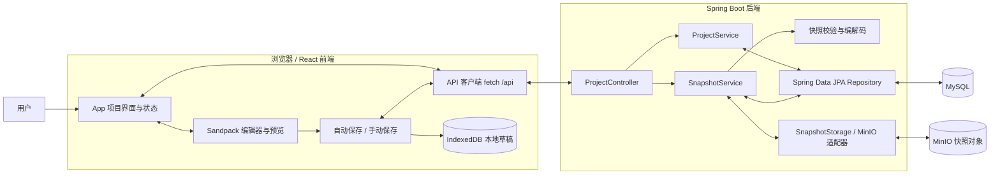
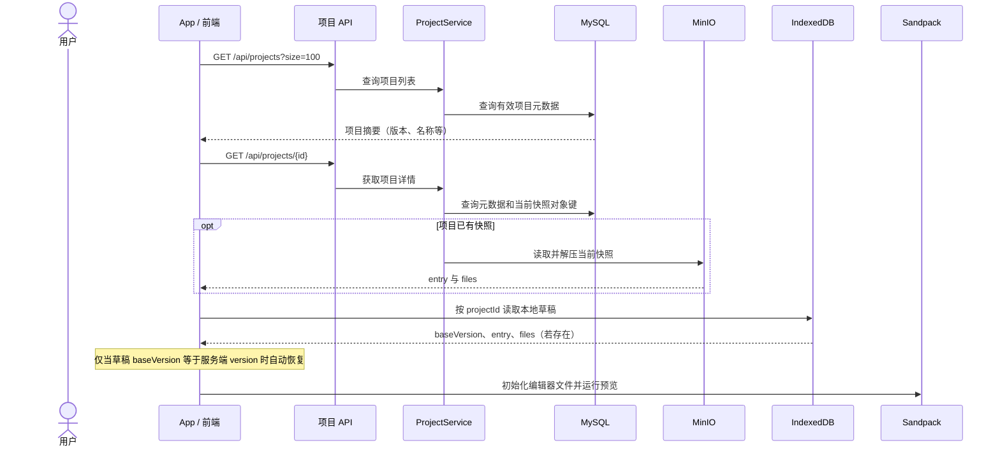
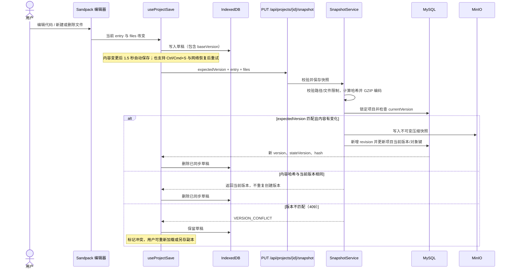
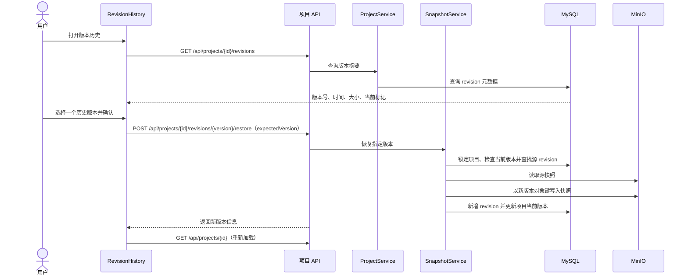

# 当前项目数据流

本文描述当前已实现的单人编辑器数据流。浏览器中的 Sandpack 负责编辑和预览；后端负责项目元数据、快照版本管理；MySQL 保存结构化元数据，MinIO 保存压缩后的文件快照，IndexedDB 保存尚未同步的本地草稿。

## 总览

## 项目打开与草稿恢复

## 编辑与保存

## 版本历史与恢复

## 数据归属与一致性

| 数据 | 存放位置 | 说明 |
| --- | --- | --- |
| 项目名称、模板、入口、当前版本与对象键、状态 | MySQL `Project` | 删除采用软删除；元数据更新使用 `If-Match`/状态版本保护。 |
| 版本号、对象键、内容哈希、压缩大小、创建时间 | MySQL `ProjectRevision` | 每次内容变化或版本恢复新增一条版本记录。 |
| entry 与完整文件集合 | MinIO | 按项目与版本保存 GZIP 压缩快照，文件内容不存入 MySQL。 |
| 尚未保存的 entry 与文件集合 | 浏览器 IndexedDB | 以 projectId 为键，记录其基于的服务端版本；版本相符才自动恢复。 |
| 当前编辑内容与运行预览 | 浏览器内存 / Sandpack | Sandpack 在客户端运行项目代码，后端不执行用户代码。 |

恢复旧版本会复制其快照内容并创建一个新的当前版本，历史记录不会被覆盖。项目快照保存使用项目当前内容版本做并发检查；项目重命名、删除等元数据操作则使用独立的 `stateVersion` / ETag 检查。
