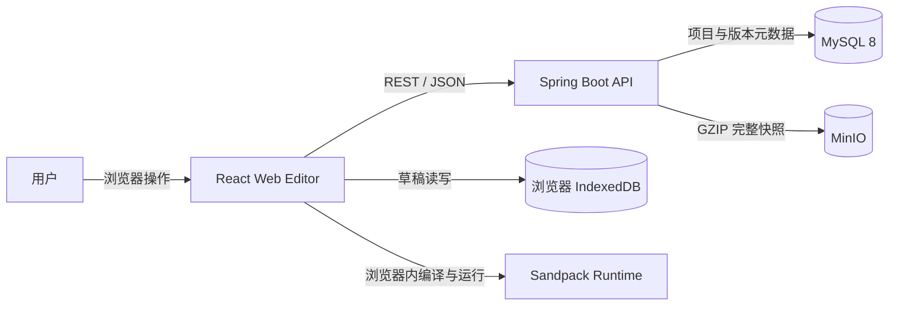
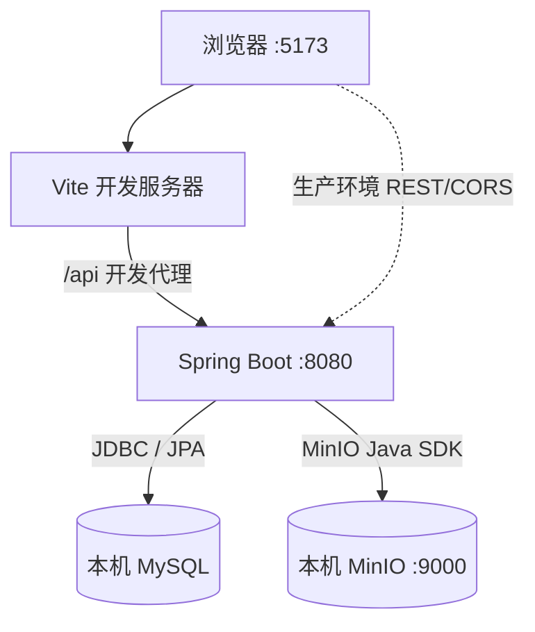
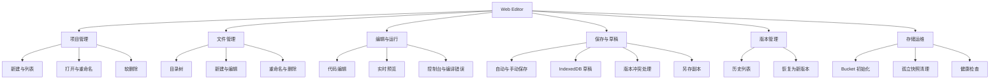
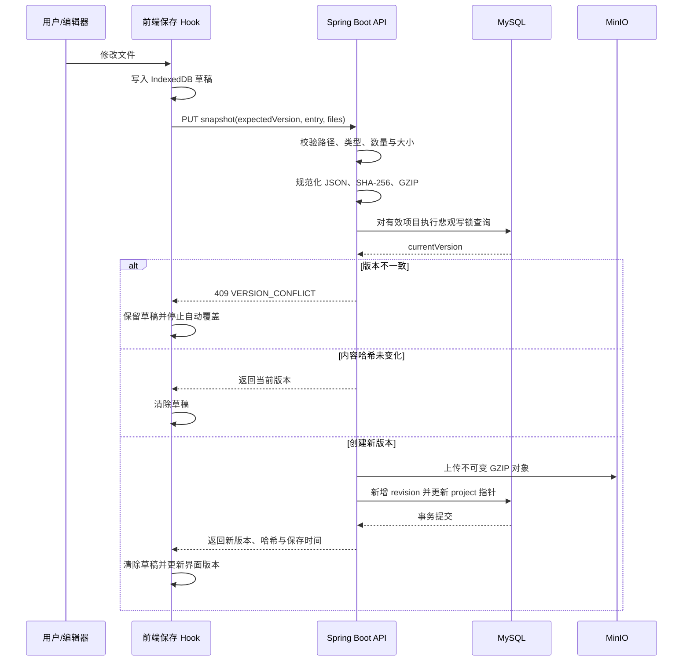
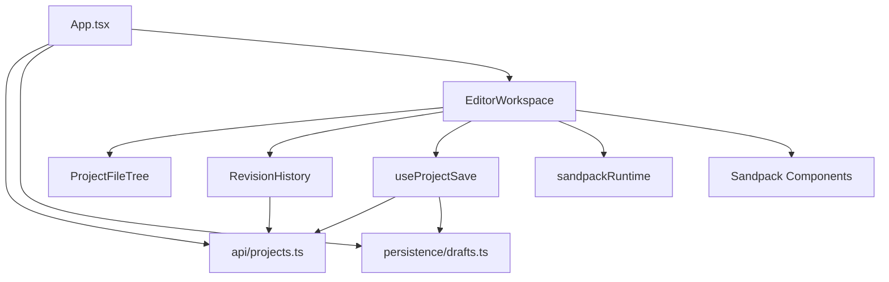
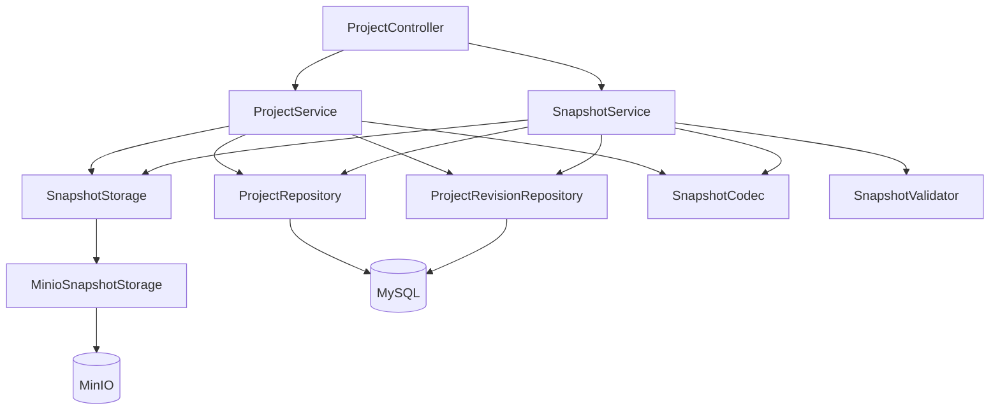
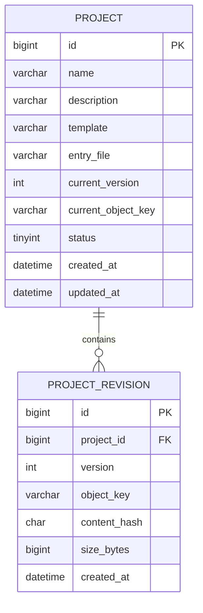

# Web Editor 项目架构 v1

> 历史归档：本文记录 V1 阶段行为，不代表当前 V2。旧匿名项目、快照写入及历史接口已隔离/关闭；当前说明见 [V2 索引](../V__2/README.md)，本地操作见 [开发指南](../V__2/development.md)。

> 文档版本：v1  
> 整理日期：2026-09-22  
> 依据：当前仓库代码、数据库迁移、运行配置及现有说明文档  
> 文档定位：描述 V1 交付时已经实现的架构，不代表当前 V2 架构

## 1. 项目概述

Web Editor 是一个面向 HTML、CSS 和 JavaScript 的浏览器在线编辑器。用户可在浏览器中管理项目和文件、编写代码、实时预览运行结果、查看控制台信息，并通过后端保存项目快照和版本历史。

系统采用前后端分离架构：

- 前端负责编辑体验、浏览器内构建与运行、预览、控制台以及本地草稿；
- 后端负责项目元数据、快照校验、版本控制和统一 REST API；
- MySQL 保存项目与版本元数据；
- MinIO 保存完整、不可变的 GZIP 项目快照；
- 用户代码只在 Sandpack 提供的浏览器沙箱中构建和执行，后端不执行用户代码。

### 1.1 当前能力边界

当前已实现：

- 项目的创建、查询、打开、重命名和软删除；
- 文本文件的树形展示、新建、编辑、重命名和删除；
- HTML、CSS、JavaScript 的浏览器内实时预览；
- 运行日志和编译错误控制台；
- 1.5 秒防抖自动保存及 `Ctrl/Cmd + S` 手动保存；
- IndexedDB 本地草稿、刷新恢复和网络恢复后重试；
- 基于版本号的并发冲突检测、重新加载和另存副本；
- 版本历史查询，以及将历史内容恢复为新版本；
- MinIO Bucket 启动初始化和孤立快照定时清理。

当前不支持：

- npm 依赖的可视化管理；
- 服务端构建或执行用户代码；
- 用户体系、认证和项目权限隔离；
- 多人实时协作；
- Git 集成；
- 项目导入与导出。

## 2. 整体架构

### 2.1 系统上下文



系统边界内共有四类运行单元：浏览器前端、后端服务、关系数据库和对象存储。浏览器前端通过 `/api` 访问后端，不直接连接 MySQL 或 MinIO；MinIO 凭据仅由后端持有。

### 2.2 逻辑分层

| 层级 | 组成 | 核心职责 |
| --- | --- | --- |
| 展示与交互层 | React、项目侧边栏、工作区、文件树、版本历史 | 呈现项目和编辑状态，接收用户操作 |
| 浏览器运行层 | Sandpack Provider、代码编辑器、预览、控制台 | 管理虚拟文件，在浏览器内构建、运行和预览代码 |
| 前端状态与持久化层 | React Hooks、API Client、IndexedDB | 项目加载、保存状态机、草稿恢复、冲突处理 |
| 接口层 | Spring MVC Controller、统一响应、全局异常处理、CORS | 暴露 REST API，完成请求校验和错误映射 |
| 应用层 | `ProjectService`、`SnapshotService` | 编排项目 CRUD、快照保存、版本恢复和事务 |
| 领域与数据访问层 | JPA Entity、Repository、Validator、Codec | 表达项目与版本模型，执行校验、锁定和数据库访问 |
| 基础设施层 | MySQL、Flyway、MinIO Adapter、清理任务 | 持久化元数据和源码快照，维护存储一致性 |

### 2.3 部署与运行拓扑



本地开发由 Vite 提供前端服务，并将 `/api` 代理到 `http://localhost:8080`。后端从仓库根目录 `.env` 注入的环境变量连接本机 MySQL 与 MinIO。项目约定本地开发、集成测试和验收不使用 Docker 或 Docker Compose。

### 2.4 仓库结构

```text
front-end-editor/
├── frontend/                         # React + TypeScript 前端
│   ├── src/
│   │   ├── api/                      # REST API 客户端
│   │   ├── editor/                   # 编辑器、文件树、预览、控制台、版本历史
│   │   ├── hooks/                    # 保存状态机
│   │   ├── persistence/              # IndexedDB 草稿存储
│   │   ├── test/                     # 前端测试配置
│   │   ├── types/                    # API 与项目类型
│   │   ├── App.tsx                   # 项目列表与工作区编排
│   │   └── main.tsx                  # 前端入口
│   └── package.json
├── backend/                          # Spring Boot 后端
│   ├── src/main/java/com/webeditor/
│   │   ├── project/
│   │   │   ├── controller/           # 项目 REST Controller
│   │   │   ├── application/          # 项目、快照、校验与编解码服务
│   │   │   ├── domain/               # Project、ProjectRevision 实体
│   │   │   └── repository/           # JPA Repository
│   │   ├── storage/                  # MinIO 适配、Bucket 初始化、孤立对象清理
│   │   └── common/                   # 配置、健康检查、统一响应与异常
│   ├── src/main/resources/
│   │   ├── db/migration/             # Flyway 数据库迁移
│   │   └── application.yml           # 后端配置
│   └── pom.xml
├── docs/                             # 项目文档
├── .env                              # 本地运行配置，不提交凭据
├── .env.example                      # 配置模板
└── README.md
```

## 3. 功能架构

### 3.1 功能模块视图



### 3.2 项目管理

项目列表按 `updatedAt` 倒序加载，前端启动后默认打开列表中的第一个项目。项目创建时保存名称、模板和入口文件，首次打开尚无服务端快照的项目时，前端使用内置的 HTML、CSS、JavaScript 默认文件。

删除采用软删除：`project.status` 从 `1` 改为 `0`，项目列表、详情和版本操作只面向有效项目。当前实现不会在软删除时同步移除版本元数据或快照对象。

### 3.3 文件管理与浏览器运行

文件以 `Record<文件绝对路径, { code }>` 的形式作为完整集合管理。文件树根据路径动态构造目录结构，支持文件的新建、打开、重命名和删除。入口文件不可重命名或删除，项目至少保留一个文件。

Sandpack 工作区由以下部分组成：

- `SandpackProvider`：持有虚拟文件与运行时状态；
- `SandpackCodeEditor`：多标签代码编辑、行号和自动换行；
- `SandpackPreview`：自动运行并实时预览；
- `SandpackConsole`：展示日志及编译错误；
- `ProjectFileTree`：自定义树形文件管理；
- `RevisionHistory`：版本历史弹层及恢复入口。

打开新项目或恢复版本后，使用 `projectId-version` 作为 Provider Key 重建 Sandpack 环境，避免前一个项目的运行状态残留。运行时会为 HTML 补充 UTF-8 charset；若快照包含 `/package.json`，会补齐 Sandpack 所需的 Vite 启动脚本和运行依赖，但不会修改服务端持久化的原始文件内容。

### 3.4 保存状态与本地草稿

前端保存状态机包含：

| 状态 | 含义 | 主要行为 |
| --- | --- | --- |
| `saved` | 当前内容已保存 | 清除对应 IndexedDB 草稿 |
| `dirty` | 存在未保存变更 | 写入草稿，1.5 秒后自动保存 |
| `saving` | 正在请求后端 | 合并保存期间产生的后续变更 |
| `failed` | 网络或服务保存失败 | 保留草稿，等待手动保存或网络恢复 |
| `conflict` | 服务端版本与本地基准版本不一致 | 停止自动覆盖，提供重新加载或另存副本 |

草稿以 `projectId` 为主键保存在浏览器 IndexedDB 的 `web-editor/drafts` Object Store 中，包含基准版本、入口文件、完整文件集合和更新时间。只有草稿的 `baseVersion` 与服务端当前版本一致时才自动恢复；旧版本草稿只给出提示，不会覆盖较新的服务端内容。

### 3.5 快照保存链路



保存期间若继续产生修改，前端在本次保存结束后继续保存最新内容，避免并发发起多个保存请求。MySQL 和 MinIO 不能参与同一个本地事务，因此后端先上传不可变对象，再提交数据库指针；若数据库事务失败，会立即尝试删除刚上传的孤立对象。

### 3.6 版本历史与恢复

版本列表按版本号倒序返回。恢复操作不会将 `currentVersion` 回退，而是读取目标版本快照并复制为一个新的版本对象。例如当前版本为 3，恢复版本 1 后会生成版本 4，因而版本历史始终单调递增并保留完整审计轨迹。

恢复同样校验 `expectedVersion` 并对项目行加悲观写锁。如果其他会话已经保存了新版本，则返回 `409 VERSION_CONFLICT`。

### 3.7 存储维护

后端启动时可自动检测并创建私有 MinIO Bucket。定时清理任务扫描 `projects/` 前缀下的对象，仅删除同时满足以下条件的对象：

- 对象已超过配置的保护期，默认 24 小时；
- `project_revision` 中不存在该 `object_key` 的引用。

默认清理时间为每天 03:30。该机制用于兜底处理数据库事务失败、进程中断等场景遗留的孤立对象。

## 4. 技术架构

### 4.1 技术栈

| 领域 | 技术 | 当前用途 |
| --- | --- | --- |
| 前端框架 | React、React DOM、TypeScript | 组件化 UI、状态与类型模型 |
| 前端构建 | Vite、`@vitejs/plugin-react` | 开发服务器、打包和 `/api` 代理 |
| 在线编辑与运行 | `@codesandbox/sandpack-react` 2.20.x | 虚拟文件、代码编辑、浏览器内构建、预览和控制台 |
| 浏览器持久化 | IndexedDB | 按项目保存未提交草稿 |
| 前端测试 | Vitest、Testing Library、jsdom、fake-indexeddb | 组件、保存 Hook、文件树和草稿相关测试 |
| 后端运行时 | Java 21、Spring Boot 3.5.6 | REST 服务和应用运行时 |
| Web 与校验 | Spring Web MVC、Bean Validation | API、参数校验、CORS 和异常处理 |
| 数据访问 | Spring Data JPA、Hibernate | 领域实体映射、分页、查询和行锁 |
| 数据库 | MySQL 8 | 项目及版本元数据 |
| 数据库迁移 | Flyway | 表结构与索引版本管理 |
| 对象存储 | MinIO Java SDK 8.5.17 | 保存和读取 GZIP 完整快照 |
| 后端测试 | Spring Boot Test、JUnit、H2 | Controller、应用服务和基础设施契约测试 |
| 构建工具 | npm、Maven | 前后端依赖、检查、测试和构建 |

前端依赖中 React、TypeScript 和 Vite 使用 `latest` 范围，实际可重现版本由 `package-lock.json` 锁定；后端依赖由 Maven POM 和 Spring Boot Parent 管理。

### 4.2 前端组件与依赖关系



`App.tsx` 是页面级编排入口，负责项目列表、项目加载和项目级操作；`EditorWorkspace` 聚合编辑器能力；`useProjectSave` 封装保存状态机；API Client 统一处理响应信封和错误；IndexedDB 模块独立承担草稿持久化。

### 4.3 后端模块与依赖关系



后端以业务模块而非传统全局技术层组织。`project` 模块内部仍保持 Controller、Application、Domain、Repository 的职责分离；`storage` 通过 `SnapshotStorage` 接口隔离 MinIO 实现，便于应用服务测试和替换存储适配器。

### 4.4 REST API

基础路径为 `/api`，除 `204 No Content` 外，成功响应统一包装为 `{ data, message, status }`。

| 方法 | 路径 | 职责 |
| --- | --- | --- |
| `GET` | `/health` | 服务健康检查 |
| `POST` | `/projects` | 创建项目 |
| `GET` | `/projects?page=&size=` | 分页查询有效项目元数据 |
| `GET` | `/projects/{id}` | 查询项目及当前完整快照 |
| `PUT` | `/projects/{id}` | 更新项目元数据 |
| `DELETE` | `/projects/{id}` | 软删除项目 |
| `PUT` | `/projects/{id}/snapshot` | 保存完整文件快照 |
| `GET` | `/projects/{id}/revisions` | 查询版本历史 |
| `POST` | `/projects/{id}/revisions/{version}/restore` | 将指定历史内容恢复为新版本 |

全局异常处理将校验失败、资源不存在、版本冲突、存储不可用和未知异常映射为稳定错误码，不向客户端暴露数据库、MinIO 异常或堆栈。

### 4.5 数据架构



主要约束：

- `project.current_version >= 0`，`status` 仅为 `0` 或 `1`；
- `(project_id, version)` 唯一，保证项目内版本号唯一；
- `(project_id, content_hash)` 为普通索引，允许版本恢复时复用历史内容哈希；
- `project.current_object_key` 指向当前版本的 MinIO 对象；
- 源码正文不进入 MySQL，只存储在 MinIO 快照中。

### 4.6 快照格式与对象组织

每个版本是一个完整项目快照，逻辑结构为：

```json
{
  "entry": "/index.html",
  "files": {
    "/index.html": { "code": "..." },
    "/styles.css": { "code": "..." },
    "/index.js": { "code": "..." }
  }
}
```

编码时先按路径排序文件集合，序列化为 JSON，计算 SHA-256，再使用 GZIP 压缩。MinIO 对象键格式如下：

```text
projects/{projectId}/revisions/{version}-{sha256}.json.gz
```

完整快照设计简化了项目加载、版本恢复、哈希去重判断和一致性管理，代价是每次保存都需上传全部文件内容。

### 4.7 一致性与并发控制

系统同时使用两层并发保护：

1. 前端在保存请求中携带当前 `expectedVersion`；
2. 后端事务内通过 `PESSIMISTIC_WRITE` 锁定项目行，再比较数据库当前版本。

这保证多个浏览器会话同时编辑时，较旧会话无法静默覆盖新版本。内容哈希与当前版本一致时不创建重复版本；恢复历史版本则显式创建一个哈希可重复的新版本。

跨 MySQL 与 MinIO 的一致性采用“不可变对象 + 数据库指针 + 补偿删除 + 定时清理”策略：

- 已写入的版本对象不覆盖；
- 数据库只在对象上传成功后更新指针；
- 数据库事务失败时尝试删除对象；
- 即时补偿失败时，由孤立对象定时清理兜底。

### 4.8 校验与安全边界

- 单项目最多 100 个文件；
- 单文件 UTF-8 内容最大 1 MB；
- 未压缩快照最大 10 MB；
- 允许扩展名：`html`、`css`、`js`、`json`、`txt`、`md`；
- 文件路径必须以 `/` 开头，长度不超过 255，拒绝 `..`、`.`、反斜杠、空字符、空路径段和重复分隔符；
- 入口文件必须存在于文件集合中；
- 用户代码仅在浏览器 Sandpack 沙箱内运行；
- MinIO Bucket 为私有存储，前端不接触访问密钥；
- CORS 来源通过环境变量限制，开发环境默认允许 `http://localhost:5173`；
- 后端禁止在错误响应中包含堆栈和内部异常消息；
- 当前尚无认证、授权和租户隔离，不能直接按多用户生产系统对外开放。

### 4.9 配置与可观测性

后端通过环境变量配置数据库、MinIO、CORS 和清理任务。仓库根目录 `.env` 用于本地运行，真实凭据不得提交。主要配置项包括：

| 配置类别 | 环境变量 |
| --- | --- |
| MySQL | `DB_URL`、`DB_USERNAME`、`DB_PASSWORD` |
| MinIO | `MINIO_ENDPOINT`、`MINIO_ACCESS_KEY`、`MINIO_SECRET_KEY`、`MINIO_BUCKET` |
| 存储初始化 | `MINIO_INITIALIZE_BUCKET` |
| 跨域 | `CORS_ALLOWED_ORIGINS` |
| 孤立对象清理 | `ORPHAN_CLEANUP_CRON`、`ORPHAN_CLEANUP_GRACE_PERIOD` |

当前可观测性以 Spring 日志和 `/api/health` 健康接口为主；尚未集成指标、链路追踪、集中式日志和外部依赖深度健康检查。

## 5. 关键架构决策摘要

| 决策 | 当前选择 | 主要原因与影响 |
| --- | --- | --- |
| 用户代码执行位置 | 浏览器 Sandpack | 后端不执行不可信代码，降低服务端安全风险 |
| 源码存储 | MinIO 完整快照 | 与元数据分离，适合不可变版本和对象存储 |
| 元数据存储 | MySQL | 支持事务、约束、分页、版本指针和行锁 |
| 草稿存储 | 浏览器 IndexedDB | 网络失败或刷新时保留未保存内容 |
| 并发策略 | 版本号 + 悲观行锁 | 防止多会话静默覆盖，冲突显式交由用户处理 |
| 版本恢复 | 复制历史快照为新版本 | 保留线性、单调递增的完整历史 |
| 跨存储一致性 | 上传对象后提交数据库，失败补偿 | 适应 MySQL 与 MinIO 无分布式事务的现实 |
| 删除策略 | 项目软删除 | 保留元数据与历史，当前未提供彻底清除流程 |

## 6. 当前架构风险与演进关注点

以下内容是基于当前实现识别的边界，不表示本版本已经承诺实施：

- 缺少认证与授权，所有 API 当前处于同一信任边界；
- 完整快照简单可靠，但大项目或高频保存会增加网络、对象存储容量和版本记录数量；
- 前端使用 JSON 字符串指纹判断本地变更，文件规模增大时可能产生额外序列化开销；
- 项目软删除后其版本仍被数据库引用，因此不会被孤立快照任务清理；后续若需释放空间，应设计带保留期的级联清理流程；
- 健康接口仅反映应用进程可响应，不能证明 MySQL 和 MinIO 当前可用；
- 浏览器本地草稿按项目 ID 保存，未实现跨设备同步、草稿版本浏览或手动处置旧草稿；
- 前端依赖声明大量使用 `latest`，更新依赖时应依赖 Lockfile 并执行完整回归验证。

## 7. 架构结论

当前项目形成了职责清晰的轻量前后端分离架构：浏览器侧专注代码编辑和安全沙箱运行，Spring Boot 侧专注业务校验、版本编排与持久化；MySQL 管理强一致元数据，MinIO 管理不可变源码快照，IndexedDB 负责未保存草稿兜底。核心保存链路已经覆盖内容去重、并发冲突、跨存储失败补偿和孤立对象清理，适合作为单用户或可信环境下的 Web 前端编辑器 v1 基础架构。
