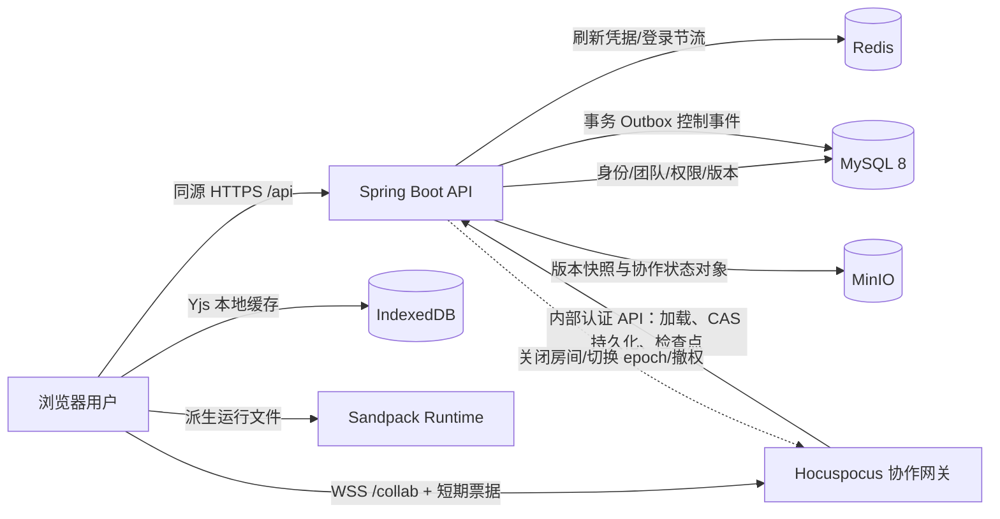
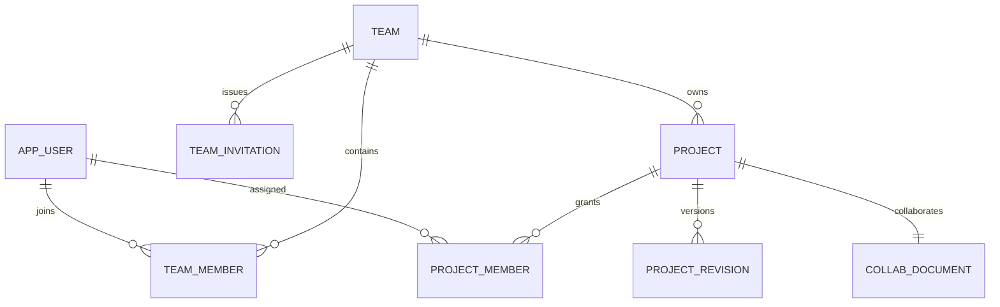
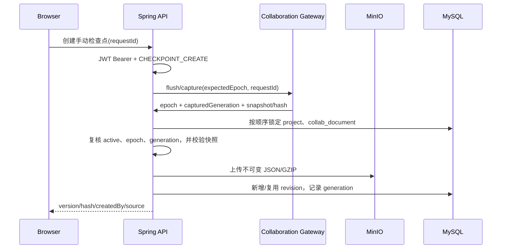

# Web Editor V2：身份系统与多人在线编辑器整体开发总方案

> 文档版本：V2.0 方案稿  
> 编制日期：2026-09-22  
> 适用仓库：`front-end-editor`  
> 文档性质：V2 开发的架构基线、范围边界和实施总纲  
> 事实优先级：当前代码与 Flyway 迁移 > `docs/V__1/架构v-1.md` > V1 其他说明文档 > 历史规划

## 1. 文档目标

V2 在现有单人 Web 编辑器上引入两项核心能力：

1. 正式身份系统：用户、JWT 登录与刷新凭据、团队、邀请和项目级权限；
2. 多人在线编辑：同项目多用户实时编辑、远端光标、断线恢复、协作状态持久化、低频版本检查点和在线版本恢复。

本方案同时定义数据边界、权限边界、版本语义、失败恢复方式、迁移路径和验收标准。后续详细开发步骤必须服从本方案；如实施中需要改变这里的架构决策，应先更新本方案并完成重新审查。

### 当前实施进度

进度记录已重置。步骤 01–11 均为未开始；实施状态和验收证据应在后续完成时补录。本文其余章节描述目标架构、实施要求和验收标准，不代表当前已实现状态。

## 2. V1 现状与升级依据

### 2.1 已实现基线

当前项目已经具备：

- React、TypeScript、Vite 前端；
- Sandpack 虚拟文件、浏览器内编译、预览和控制台；
- 项目和文件管理；
- 1.5 秒防抖完整快照保存；
- IndexedDB 草稿恢复；
- 客户端 `expectedVersion` 加数据库项目行 `PESSIMISTIC_WRITE` 的快照并发保护；
- MySQL 项目/版本元数据；
- MinIO 不可变 JSON/GZIP 项目快照；
- 版本历史和“恢复为新版本”；
- 快照校验、哈希去重、失败补偿和孤立快照清理。

关键实现位置：

- `frontend/src/App.tsx`
- `frontend/src/editor/EditorWorkspace.tsx`
- `frontend/src/hooks/useProjectSave.ts`
- `frontend/src/persistence/drafts.ts`
- `backend/src/main/java/com/webeditor/project/application/ProjectService.java`
- `backend/src/main/java/com/webeditor/project/application/SnapshotService.java`
- `backend/src/main/java/com/webeditor/project/application/SnapshotValidator.java`
- `backend/src/main/java/com/webeditor/storage/OrphanSnapshotCleaner.java`
- `backend/src/main/resources/db/migration/`

### 2.2 必须保留的 V1 约束

- 用户代码只在浏览器 Sandpack 沙箱中执行；Spring Boot 和协作网关均不得执行项目代码。
- MySQL 保存结构化元数据，不保存源码正文。
- MinIO Bucket 保持私有，浏览器不得获得 MinIO 凭据。
- 用户可见历史版本继续使用规范化 JSON、SHA-256、GZIP 和不可变完整快照。
- 版本号单调递增；恢复历史内容必须生成新版本，不能回退版本号。
- 单项目最多 100 个文件、单文件最大 1 MB、未压缩快照最大 10 MB。
- 文件路径、入口文件和扩展名继续接受服务端校验。
- 项目继续采用软删除，彻底清除另行设计保留策略。
- API 继续使用统一成功/错误响应，并禁止泄露数据库、MinIO、JWT、刷新凭据、票据和堆栈信息。
- 本地开发及需要运行应用的功能验收使用仓库根目录 `.env`，连接本机 MySQL、MinIO 和 Redis；不使用 Docker 或 Docker Compose。

### 2.3 协作开发前必须修复的 P0 问题

1. `ProjectService.update/delete` 没有行锁，`Project` 也没有 JPA `@Version`。它们与检查点保存并发时可能覆盖版本指针或状态。V2 必须增加独立 `lock_version` 并统一项目写操作的锁顺序。
2. 当前孤儿清理扫描 `projects/`，只根据 `project_revision.object_key` 判断引用。Yjs 对象必须使用独立的 `collab/` 顶层前缀和独立清理规则，否则活动协作状态可能在保护期后被误删。
3. 当前入口文件同时存在于 `project.entry_file` 和快照 `entry`。V2 实时阶段以 Y.Doc 的稳定 `entryFileId` 为事实源，`project.entry_file` 只保存最近检查点的路径投影。
4. 当前恢复接口只更新版本快照，无法重置在线房间。V2 必须用 epoch 和恢复协调器替代单纯的数据库恢复。
5. 当前 Sandpack 文件既是编辑源又是运行源，运行时补丁存在回写到快照的风险。V2 必须把 Y.Doc 原始文件与 Sandpack 派生运行文件彻底分离。

## 3. V2 范围

### 3.1 本期包含

- 本地用户名/邮箱和密码身份；
- Spring Security、短期 JWT Bearer、Redis 刷新凭据和安全 JSON 错误响应；
- 开放自助注册、用户自主创建团队、邀请加入及申请加入团队；
- 团队、团队成员、邀请、项目成员和有效权限；
- 短期协作票据；
- 独立 Node.js/Hocuspocus 协作网关；
- Yjs CRDT、Monaco、`y-monaco`、`y-indexeddb`；
- 多文件实时协作、Presence、远端光标和 Viewer 只读；
- Y.Doc 二进制持久化及 generation CAS；
- 手动检查点、周期检查点、末位成员离房检查点；
- epoch 化历史恢复、删除关房和权限撤销；
- 按身份、团队、权限、协作、版本和恢复流程完成功能验收。

### 3.2 本期不包含

- 企业 SSO、SAML、MFA、短信登录和复杂账号找回；
- 跨区域、多活或无状态多实例协作集群；
- 首期 Redis 广播；
- Git 集成、代码评审、评论、聊天、音视频；
- npm 依赖可视化管理；
- 服务端构建或执行用户代码；
- 二进制文件及超出 V1 白名单的源码类型；
- 项目硬删除和法规级数据保留系统。

## 4. 总体架构



### 4.1 运行单元

| 单元 | 技术 | 主要职责 |
| --- | --- | --- |
| 浏览器应用 | React、Router、Monaco、Yjs、Sandpack | 身份交互、团队/项目 UI、协同编辑、离线缓存、浏览器运行 |
| 业务 API | Spring Boot 3.5、Spring Security、JPA | 身份、JWT 签发/校验、授权、项目、版本、协作票据和对象存储 |
| 协作网关 | Node.js、TypeScript、Hocuspocus、Yjs | WebSocket 房间、CRDT 同步、Awareness、只读连接、Y.Doc 编解码 |
| MySQL | MySQL 8、Flyway | 用户、团队、权限、项目、版本、协作指针和 Outbox |
| Redis | Spring Data Redis | 刷新凭据的摘要/轮换与登录节流；不承担协作房间广播 |
| MinIO | 私有 Bucket | 不可变版本快照和不透明 Y.Doc 二进制状态 |

### 4.2 信任边界

- 浏览器是不可信客户端；前端传入的 `userId`、角色、团队和权限不得作为授权依据。
- Spring Boot 是业务授权和持久化权威。
- 协作网关是受信内部服务，但只能通过独立内部凭据访问最小范围接口。
- 用户代码 iframe 不得获得访问 JWT、刷新凭据、协作票据、内部 HMAC 密钥或 MinIO 凭据。
- Awareness 是临时展示数据，不是授权身份来源。

## 5. 身份、团队和权限方案

### 5.1 认证方式

- 密码使用 Spring Security `DelegatingPasswordEncoder`，初始编码采用 bcrypt；数据库只保存哈希。
- REST 使用短期签名 JWT，通过 `Authorization: Bearer` 请求头传递，不使用登录 Cookie 或服务器 Session。JWT 只表明身份，MySQL 保留 `token_version` 和实时团队/项目 ACL。
- 登录同时返回 Redis 管理的单次轮换刷新凭据。访问 JWT 和刷新凭据只保存在浏览器页面内存；整页刷新或新标签页必须重新登录。退出所有设备或改密通过 MySQL `token_version` 使所有设备的旧凭据失效，同时递增 `authz_version`，使旧协作票据失效并由 Outbox 关闭连接。
- 浏览器业务 API 不开放跨源 CORS，也不生成 CSRF Token；前端、`/api`、`/collab` 保持同源。WebSocket 继续使用独立短期票据，不在 URL 中携带 JWT。
- 正式身份系统采用开放自助注册：未认证用户可创建账号，无需邀请码或人工预先批准；注册请求不能指定团队角色或账号状态。注册不自动登录，注册完成后显式登录。`app_user` 不设计账号状态字段。
- 每个已登录用户都可以创建团队并成为该团队首位 `OWNER`。加入他人团队可接受有效邀请，或向允许申请加入的团队提交申请；只有团队 OWNER/ADMIN 批准后才创建 ACTIVE membership。申请中和被拒绝的用户没有团队或项目访问权。
- 团队加入策略为 `REQUEST`（允许成员申请，默认）或 `INVITE_ONLY`（仅邀请）；团队可按 slug/分享页公开显示基本资料，目录信息不包含成员、项目或私有内容。只有 OWNER 可更改加入策略，ADMIN 可审批申请。
- 登录按“规范化登录名 + IP”限流，连续失败实施递增延迟。
- 不设置平台管理员、平台角色或平台介入；用户通过注册获得身份，业务权限仅来自当前团队/项目成员关系。Redis 登录节流有 TTL，不改变账号状态。
- 每个受保护请求由 Spring Security 链中的 `JwtAuthenticationFilter` 统一解析并验证 JWT 签名、签发方、受众和期限，从 MySQL 确认用户存在且 `token_version` 一致后，构造 `Authentication` 放入当前请求的 `SecurityContext`，再进入 Controller。团队/项目 ACL 仍由服务层按当前数据库状态授权。退出所有设备或改密时递增 `token_version`，旧 JWT 和刷新凭据立即无效；协作连接通过 Outbox 关闭。匿名登录统一返回认证失败，不暴露用户是否存在。
- 修改密码后递增 `token_version` 并要求全部设备重新登录。JWT 密钥轮换、刷新凭据空闲/绝对期限、并发 family 上限和重放拒绝由配置明确控制。

### 5.2 组织模型



团队角色：

- `OWNER`：团队设置、成员、邀请、所有项目和团队删除；
- `ADMIN`：成员管理、邀请、创建和管理项目；
- `MEMBER`：访问团队可见项目。

创建团队是登录用户的自助操作；创建事务同时建立团队和首位 OWNER membership。团队加入申请按 `(team_id,user_id)` 保证最多一个待处理申请；申请人可撤回，OWNER/ADMIN 可批准或拒绝，终态不可重复消费。批准事务锁定团队和申请，复核团队仍 ACTIVE、策略允许申请且申请人存在且不是有效成员，然后创建 MEMBER membership、关闭申请。团队策略改为 `INVITE_ONLY` 后，已有申请不自动获批，审批时重新检查策略。

项目角色：

- `MANAGER`：项目设置、成员、删除、检查点和恢复；
- `EDITOR`：实时编辑和创建检查点；
- `VIEWER`：只读查看、预览和 Presence。

项目可见性：

- `TEAM`：团队成员至少获得 Viewer 能力；
- `RESTRICTED`：仅显式项目成员及团队 OWNER/ADMIN 可访问。

任何项目权限成立都必须同时满足：用户存在、团队为有效状态、用户存在有效 `team_member`。本期不实现显式 deny/override；`project_member` 只能在团队成员关系之上授予额外项目能力，有效角色取用户可获得角色中的最高权限，不能让已退出团队的用户继续访问。移除团队成员时，在同一事务删除/失效其全部 `project_member`；权限服务仍把团队成员关系作为硬前提，形成双重保护。

`app_user.authz_version` 是用户授权撤销水位。退出所有设备、改密、团队成员增删或角色变化、项目成员增删或角色变化时，必须在同一事务递增所有受影响用户的版本。

角色变更规则：

- 团队必须始终至少有一名有效 `OWNER`；最后一名 OWNER 不得退出、被移除或被降级，必须先转移所有权。
- `OWNER` 可授予 OWNER/ADMIN/MEMBER；`ADMIN` 最多授予 ADMIN/MEMBER，不能创建或降级 OWNER。
- 团队 OWNER/ADMIN 可授予项目 MANAGER；项目 MANAGER 最多授予 EDITOR/VIEWER，不能授予超越自己的角色。
- 操作者不能通过修改自身角色提升权限。

### 5.3 授权动作

后端以动作而不是 UI 按钮为授权单位：

```text
TEAM_CREATE
TEAM_READ
TEAM_SETTINGS_MANAGE
TEAM_ARCHIVE
TEAM_MEMBER_MANAGE
TEAM_INVITATION_MANAGE
PROJECT_CREATE
PROJECT_READ
PROJECT_EDIT
PROJECT_MANAGE
PROJECT_DELETE
CHECKPOINT_CREATE
REVISION_READ
REVISION_RESTORE
PROJECT_MEMBER_MANAGE
```

统一由 `ProjectAccessService`/团队授权服务计算有效权限，不存在平台全局业务权限。不可见资源返回 404 防止 ID 枚举；资源可见但动作不足返回 403。列表查询必须在 SQL 层按当前用户范围过滤，禁止“先查全部再在 Java 过滤”。

## 6. 数据架构

### 6.1 新增及变更数据结构

| 数据结构 | 关键字段或变化 |
| --- | --- |
| `app_user` | 登录名、邮箱、密码哈希、显示名、颜色、`token_version`、`authz_version`、密码修改时间 |
| Redis 刷新凭据 | 独立命名空间、摘要、family、单次轮换与 TTL；不在 MySQL 建 Session 表 |
| `team` | 名称、创建人、状态、加入策略、时间戳 |
| `team_member` | 团队、用户、角色、状态、加入时间，联合唯一 |
| `team_invitation` | Token 哈希、角色、过期/接受/撤销时间、创建人 |
| `team_join_request` | 用户申请加入团队及审批状态 |
| `project_member` | 项目、用户、角色、状态、授权人，联合唯一 |
| `project` | 新增 `team_id`、`created_by`、`visibility`、`lock_version`、只标识旧匿名数据的 `legacy_unowned` |
| `project_revision` | 新增 `created_by`、`source`、`collab_epoch`、`collab_generation`；`LEGACY` 记录的协作字段可空 |
| `collab_document` | `collaboration_mode`、`epoch`、`generation`、对象键、哈希、大小、`bootstrap_revision_version`、`last_checkpoint_version`、`last_checkpoint_generation` |
| `collab_control_event` | 聚合类型、聚合 ID、聚合内序号、关闭房间、切换 epoch、用户/成员撤权等事务 Outbox 事件 |
| `collab_operation` | fence token、操作类型、预期版本/epoch、`PREPARED/COMMITTED/ABORTED` 状态、目标 epoch、租约时间 |

不得改写已经发布的 V1/V2 Flyway 文件；所有变化使用后续增量迁移。

### 6.2 三种版本维度

必须严格区分：

| 维度 | 含义 | 何时变化 |
| --- | --- | --- |
| `project.current_version` | 用户可见的不可变检查点版本 | 手动、周期、离房检查点或恢复 |
| `collab_document.epoch` | 一次协作文档生命周期 | 历史恢复、整房间重置或维护型压缩 |
| `collab_document.generation` | 当前 epoch 内持久化 Y.Doc 的 CAS 代次 | 网关成功持久化新状态 |

`generation` 在 `(projectId, epoch)` 内单调递增，每个新 epoch 从 0 开始。generation 0 表示尚未生成 Y.Doc 对象，网关需从 `bootstrap_revision_version` 初始化；首次成功持久化为 generation 1。普通字符编辑只产生 Yjs Update，不直接增加 `current_version`。

`last_checkpoint_generation` 表示当前 epoch 中已经纳入最近检查点的最大 generation，更新只能使用单调 `max` 语义。普通 `MANUAL/AUTO/LEAVE` 检查点若投影内容哈希与当前 revision 相同，可不新增 revision，但仍推进该字段；`RESTORE` 无论哈希是否相同都必须创建新的单调 revision。普通检查点增加 `(project_id, collab_epoch, collab_generation)` 唯一约束。

### 6.3 MinIO 对象命名空间

```text
projects/{projectId}/revisions/{version}-{hash}.json.gz
collab/projects/{projectId}/epochs/{epoch}/{generation}-{hash}.yjs
```

- `projects/` 仅存用户可见不可变版本，沿用现有 revision 引用判断。
- `collab/` 存 Y.Doc 二进制 generation，由 `collab_document` 引用并使用独立保留/清理任务。
- 协作状态使用 `application/octet-stream`，版本快照使用 `application/gzip`。
- 浏览器和协作网关均不直接持有 MinIO 凭据；网关通过 Spring 内部 API 存取。

### 6.4 旧匿名项目隔离与新项目基线

V1 没有用户身份，旧项目没有可验证的所有者。本期不认领、分配、导入或展示这些项目，也不创建平台管理员或迁移团队。V6 在停写维护窗口给迁移前既有项目标记 `legacy_unowned=true`；原项目与 revision/MinIO 对象保持原样。V2 的列表、详情、版本、对象读取、复制、恢复、删除、协作票据和内部网关入口全部要求 `legacy_unowned=false` 及有效团队授权；旧匿名项目一律不可访问。不得通过传入旧项目 ID 或直接对象键绕过隔离。

V2 新项目由服务端 `ProjectTemplateService` 创建团队归属、创建者和初始 revision 1，`legacy_unowned=false`；不能再由每个浏览器分别写入 `DEFAULT_FILES`。V7 约束新项目必须有 `team_id/created_by`，只允许已标记的旧项目为空；V8 为旧 revision 补 `source=LEGACY`，允许其 `created_by` 为空，新 revision 则必须记录来源与创建者语义。步骤 03 不为旧 `current_version=0` 项目补 revision，也不创建 `collab_document`。

步骤 05 创建 `collab_document` 表，仅为 `legacy_unowned=false` 的项目（含可恢复的软删除项目）按其当前 revision 回填唯一描述行：`epoch=1, generation=0, bootstrap_revision_version=current_version, last_checkpoint_version=current_version, last_checkpoint_generation=0`。步骤 05 同时升级新项目创建流程，使此后新项目在 revision 1 之外一并创建协作描述。步骤 05 的退出门禁只要求非旧匿名项目恰有一条 `collab_document`；协作 feature flag 在此之前保持关闭。网关首次打开时以 CAS 方式只初始化一次。

## 7. 协作文档和编辑器设计

### 7.1 唯一事实源

```text
Y.Doc
├── y-monaco ──> Monaco 编辑器
├── 文件结构订阅 ──> React 文件树
└── 防抖单向投影 ──> SandpackProvider ──> Preview / Console
```

Y.Doc 是实时项目内容唯一事实源。Sandpack 只接收派生文件，不允许把运行时补丁反写 Y.Doc。现有 `SandpackCodeEditor` 被 Monaco 替代，`SandpackPreview` 和 `SandpackConsole` 保留。

### 7.2 Y.Doc Schema

```text
meta: Y.Map
  schemaVersion
  epoch
  entryFileId

files: Y.Map<fileId, Y.Map>
  id
  path
  language
  deletedAt
  content: Y.Text

fileOrder: Y.Array<fileId>
```

- `fileId` 使用稳定 UUID，路径不再充当文件身份。
- 选中文件、Awareness 活动文件和入口均使用 `fileId`。
- 新建、重命名、逻辑删除和入口切换在单个 Yjs transaction 内完成。
- 删除先写 tombstone，避免“远端删除、当前用户继续输入”直接丢失内容；后续 epoch 压缩时清理 tombstone。
- 同路径并发冲突采用确定性归一化：稳定顺序的获胜文件保留路径，其余文件生成带短 ID 的冲突路径，并在 UI 提示处理。
- 入口文件不得被删除；检查点投影前再次验证全部结构不变量和 V1 大小限制。

### 7.3 本地缓存

`y-indexeddb` 文档名至少包含：

```text
web-editor:{userId}:{projectId}:{epoch}
```

- 未完成当前用户和项目授权前不得显示本地缓存内容。
- 注销、403、项目删除、成员移除和 epoch 切换时必须销毁 provider/binding，并按策略清理或封存旧缓存。
- 旧 epoch 的 Update 永远不得合入新 epoch。
- V1 `web-editor/drafts` 不自动导入任意用户；旧草稿只允许本地显式导出，不提供旧项目认领入口。

### 7.4 状态展示

前端必须区分：

- 协作连接：`connecting/syncing/online/offline/reconnecting/forbidden/failed`；
- 网关持久化：最近一次 generation 成功时间；
- 历史检查点：`idle/creating/success/failed`。

不能把“WebSocket 已同步”“Y.Doc 已持久化”和“历史版本已创建”合并显示为同一个“已保存”。

## 8. 协作网关与票据

### 8.1 连接流程

1. 浏览器通过 JWT Bearer 请求项目详情，获得 `effectiveRole/capabilities` 和当前 epoch。
2. 浏览器调用 `POST /api/projects/{id}/collab-ticket`。
3. Spring 再次授权并签发约 60 秒有效的单用途 opaque 随机票据；V11 共享表只保存 token 摘要及 user/project/team/epoch/role/capabilities/authzVersion/过期与消费时间。
4. 票据只保存在内存，通过 Hocuspocus 认证消息传送，不得进入 URL、日志、LocalStorage 或 IndexedDB。
5. 网关在 Origin 校验后调用 Spring 内省接口；Spring 原子消费摘要并按数据库当前用户存在性、团队成员、项目权限、epoch 和 `authzVersion` 重新授权。只有复核通过才加入 `project:{id}:epoch:{epoch}` 房间。Spring 不可达时 fail closed。
6. 网关校验严格的 WebSocket `Origin` allowlist。Viewer 建立只读连接，网关拒绝其文档 Update，不能只依赖 Monaco `readOnly`。
7. 重连时重新申请票据；退出所有设备、退出团队或被撤权的用户不能凭旧凭据取得新票据。撤权前已经签发但尚未使用的票据也会因握手复核的 `authzVersion` 过旧而被拒绝；网关重启不会清除这一保障。

Opaque 票据无签名密钥或 kid。两个方向内部 API 使用互相独立的 HMAC 密钥集合与 keyId/audience，支持双钥轮换；所有秘密来自 `.env`/生产密钥管理且禁止记录。

### 8.2 双向内部接口

网关调用 Spring（`COLLAB_GATEWAY_TO_API_KEYS`）：

```http
GET  /internal/collaboration/projects/{id}/describe
GET  /internal/collaboration/projects/{id}/state?epoch={epoch}&generation={generation}
PUT  /internal/collaboration/projects/{id}/state?expectedEpoch={epoch}&expectedGeneration={generation}
GET  /internal/collaboration/projects/{id}/bootstrap?epoch={expectedEpoch}
POST /internal/collaboration/projects/{id}/checkpoints
POST /internal/collaboration/events/{eventId}/ack
POST /internal/collaboration/tickets/introspect
GET  /internal/collaboration/operations/{fenceToken}
```

Spring 调用网关（`COLLAB_API_TO_GATEWAY_KEYS`）：

```http
POST   /internal/collaboration/projects/{id}/captures
PUT    /internal/collaboration/projects/{id}/fence
POST   /internal/collaboration/projects/{id}/fence/{fenceToken}/commit
DELETE /internal/collaboration/projects/{id}/fence/{fenceToken}
POST   /internal/collaboration/control-events
```

- 二进制持久化请求携带 epoch 和期望 generation，后端用 CAS 拒绝旧房间迟到写入。
- 首次房间从 `bootstrap_revision_version` 创建 Y.Doc；generation 0 到 1 的初始化也使用 CAS，保证只有一个权威初始化结果。
- 手动检查点唯一发起者是 Spring：浏览器请求 Spring，Spring 请求网关 flush/capture，再由 Spring提交。
- 周期和末位成员离房检查点唯一调度者是网关：先持久化 generation，再调用 Spring 的幂等检查点接口。双方不得同时调度同一类型检查点。
- 每次 capture 返回 `requestId/projectId/epoch/capturedGeneration/snapshot/hash`，并保证该 generation 已持久化。
- 所有内部调用定义连接/响应超时、幂等键、关联 ID 和有限重试；不能对非幂等操作盲目重试。
- Spring 对网关返回的快照重新执行规范化和 SHA-256，不能信任网关传入的 hash。
- 两个方向分别用 HMAC 签入 keyId、audience、method、canonical path/query、content-type、body hash、timestamp、nonce；nonce 在共享数据库唯一表防重放，常量时间比较。内部请求限制体积、速率和来源，不接受任意对象键。

### 8.3 破坏性操作写栅栏

恢复和删除在提交数据库事务前必须使用持久化操作记录并同步获取网关 fence lease：

1. Spring 先创建带唯一操作 ID 的 `collab_operation(PREPARED)`，再请求网关对指定项目/epoch flush 并进入 `fencing/read-only`；网关返回 `fenceToken`、epoch 和 capturedGeneration。
2. Spring 在数据库事务内按固定顺序锁定 `project` 和 `collab_document`，重新校验请求的 `expectedVersion`、epoch、generation 及项目状态，完成恢复/删除并把操作置为 `COMMITTED`，同时写入 Outbox。
3. 数据库提交成功后，Spring 同步调用网关 `commit/finalize fence`；Outbox 用于响应丢失或进程崩溃后的最终补偿。
4. 数据库事务失败时，Spring 把操作置为 `ABORTED` 并主动解除 fence。
5. fence 租约到期时网关不得自行恢复写入，必须查询 Spring 中的操作状态：`COMMITTED` 则关闭旧房间或切换 epoch；`ABORTED` 且项目仍为原 epoch 才解栅栏；`PREPARED`、Spring 不可达或状态未知时 fail closed/续租。
6. 后端恢复任务检查长期 `PREPARED` 操作：只有确认项目仍为原状态且没有提交痕迹时才标记 `ABORTED`；否则补发 finalize。
7. 网关不可达或无法取得 fence 时，破坏性操作返回 503，不得无保护继续。

Outbox 保证提交后的最终送达，但不能替代操作开始前的同步写屏障和提交确认协议。

## 9. 保存、检查点和版本恢复

### 9.1 保存语义和旁路封堵

V1 的 1.5 秒 REST 完整快照保存退出多人编辑主链路。V2 使用：

- Yjs Update：实时同步；
- Y.Doc generation：短防抖持久化工作状态；
- 手动检查点：用户主动创建可见版本；
- 自动检查点：有变化时约每 5 分钟创建；
- 离房检查点：最后成员离开并经过短暂 grace period 后创建。

协作项目的入口只能通过 Y.Doc 结构命令修改，`PUT /api/projects/{id}` 不再接受 `entry`。项目进入 PILOT/ENABLED（即使 generation=0）或 generation>0 后，浏览器版 `PUT /api/projects/{id}/snapshot` 返回 `409 COLLABORATIVE_PROJECT_REQUIRES_CHECKPOINT`，并在步骤 09 完成后移除；检查点只能来自网关权威 capture。复制项目使用显式的服务端复制接口，不得用客户端快照覆盖已有项目。

步骤 06–08 尚未完成恢复/删除协调时，协作功能由 feature flag 控制，并禁用协作项目的旧恢复、删除及浏览器快照入口，避免形成旁路写入。

### 9.2 检查点流程



网关必须先确保持久化 capturedGeneration，再返回投影。提交阶段要求 epoch 与当前值相同、capturedGeneration 不大于当前 generation，并与 `last_checkpoint_generation` 比较：小于时作为陈旧请求拒绝/无操作；等于时只返回既有幂等结果；大于时才允许创建或复用检查点。字段更新只能取 `max`，不得倒退。检查点记录准确的 `collab_epoch/collab_generation`。如果恢复或删除先获得锁并改变 epoch/status，迟到检查点返回 `COLLAB_EPOCH_CONFLICT` 或资源不可用，绝不能创建 revision。若检查点先提交，后续恢复在更高版本上继续，版本仍单调。

检查点接口使用全局唯一 request ID 和数据库幂等记录。网关投影是多人房间权威状态，不能由任意浏览器提交完整文件作为最终状态。

### 9.3 恢复流程

历史恢复由 `RestoreCoordinator` 完成：

1. 校验 `REVISION_RESTORE`、当前版本和当前 epoch；
2. 创建持久化 fence 操作并同步取得旧房间 fence lease，保证不再接受新的编辑；
3. 按固定顺序锁定项目和 `collab_document`，在锁内重新校验 `expectedVersion`，并复核 fence 捕获的 epoch/generation；
4. 将历史快照复制为新的 revision；即使内容哈希相同也不得去重恢复事件；
5. 设置 `epoch + 1`、`generation=0`、空状态对象、`bootstrap_revision_version=新版本`、`last_checkpoint_version=新版本`、`last_checkpoint_generation=0`；
6. 在同一数据库事务写入 `RESET_PROJECT_EPOCH` Outbox 事件；
7. 网关幂等关闭旧房间；新房间由恢复快照初始化为 generation 1；
8. 客户端收到重置事件后销毁旧 provider/model/cache，获取新票据并连接新 epoch。

删除使用相同 fence 和锁顺序：先冻结并 flush，事务中软删除和写入 `PROJECT_DELETED`，再由 Outbox 关闭房间。不得让 Java 后端实现 Yjs 编解码；JSON 快照与 Y.Doc 的转换由网关负责。

### 9.4 邀请、复制和导入边界

- 邀请 Token 放在 URL fragment，前端读取后通过 POST body 交换并立即清理地址；Token 不进入代理访问日志。
- “另存副本”必须让用户明确选择“当前协作状态副本”或“最近版本副本”；前者由 Spring 请求网关 capture，后者读取指定 revision，然后创建全新项目、初始 revision 和协作描述。
- 本期不提供把客户端任意文件集合导入既有协作项目的接口；未来导入也必须表现为受管控的新 epoch 操作。

## 10. 并发、一致性和控制事件

### 10.1 项目写入并发

- `project.lock_version` 使用 JPA `@Version` 保护普通元数据更新。
- 检查点、恢复、软删除和 epoch 更新统一按 `project → collab_document` 顺序加锁。
- 内容版本 `current_version` 与 JPA `lock_version` 分离。
- 项目元数据更新使用 `If-Match`/锁版本，冲突返回稳定的 `409 PROJECT_STATE_CONFLICT`。

### 10.2 协作状态 CAS

- 网关持久化携带 `(projectId, epoch, expectedGeneration)`。
- 后端只接受当前 epoch 和 generation 的下一次原子更新。
- generation 在每个 epoch 内从 0 开始递增；旧 epoch 或过期 generation 冲突后，网关停止当前写入并重新加载描述。
- MinIO 先写不可变 generation 对象，再用短数据库事务切换指针；失败对象由独立清理任务回收。
- 有效 Update 应先应用到临时 Y.Doc 副本并执行角色、消息体、文件数量/大小及结构预算校验，验证通过后才进入权威房间和广播。若 Hocuspocus 扩展点无法保证“广播前验证”，必须增加协议拦截层，不能以“事后检查”替代。
- 违规连接被断开；房间进入异常状态时从最后有效 generation 重建，禁止覆盖有效指针。

### 10.3 事务 Outbox

以下事件必须可靠送达网关：

- `PROJECT_DELETED`
- `RESET_PROJECT_EPOCH`
- `USER_LOGGED_OUT`
- `USER_CREDENTIALS_REVOKED`
- `TEAM_MEMBER_REMOVED`
- `PROJECT_MEMBER_REMOVED`
- `ROLE_DOWNGRADED`

事件带唯一 ID、`aggregate_type`、`aggregate_id` 和聚合内顺序号，由网关幂等处理和确认。Spring dispatcher 使用有上限的指数退避；超过最大重试进入死信状态并告警，保留人工重放能力。事件定义保留期，网关重启后可按最后确认游标重放。同一项目控制事件不得乱序。首期不要求消息队列。

### 10.4 Y.Doc 维护型 rollover

tombstone 数量、Y.Doc 二进制大小或持续时间达到配置阈值时触发维护型 epoch rollover。该操作复用 fence、检查点、epoch 初始化和 Outbox 流程，保留内容但压缩 CRDT 历史；必须在 UI 和操作状态中标记为维护操作。

## 11. API 与错误契约

### 11.1 新增外部 API 分组

```text
/api/auth/**
/api/teams/**
/api/invitations/**
/api/projects/**
/api/projects/{id}/members/**
/api/projects/{id}/collab-ticket
/api/projects/{id}/checkpoints
/api/projects/{id}/revisions/**
```

认证及安全 Filter 发生的错误也必须输出现有 JSON 错误结构。至少新增：

| HTTP | 错误码 | 含义 |
| --- | --- | --- |
| 401 | `AUTHENTICATION_REQUIRED` | 缺失、过期、无效或已撤销 JWT，或匿名登录失败 |
| 403 | `ACCESS_DENIED` | 已认证但动作权限不足 |
| 409 | `PROJECT_STATE_CONFLICT` | 元数据锁版本冲突 |
| 409 | `COLLAB_EPOCH_CONFLICT` | 协作 epoch 已切换 |
| 409 | `COLLAB_GENERATION_CONFLICT` | 协作状态 CAS 冲突 |
| 410 | `INVITATION_INVALID_OR_EXPIRED` | 邀请失效、过期或已使用 |

邀请 Token、用户是否存在和登录失败原因应避免过度区分，防止账号枚举。

## 12. 前端架构演进

建议目录：

```text
frontend/src/
├── app/                 # Router、AppShell、受保护路由
├── api/                 # client、auth、teams、projects、collaboration
├── auth/                # AuthProvider、登录/注册、内存 Token
├── teams/               # 团队切换、成员和邀请
├── collaboration/       # Y.Doc schema、provider、presence、persistence
├── editor/              # Monaco、文件树、Sandpack bridge、历史
└── types/
```

关键生命周期：

```text
当前用户
→ 团队和路由项目
→ 项目详情与 capabilities
→ 短期票据
→ Y.Doc + y-indexeddb
→ HocuspocusProvider
→ MonacoBinding
→ Sandpack 单向投影
```

React StrictMode 下初始化和清理必须幂等。项目切换、注销、撤权和 epoch 重置时必须销毁 Monaco binding/model、Provider、Y.Doc observers、IndexedDB provider 和 Awareness listeners，防止幽灵连接与跨项目污染。

## 13. 安全要求

- 所有项目和版本读取先确认 `legacy_unowned=false`、用户存在、有效团队成员关系和动作权限，后读取 MinIO。
- JWT、刷新凭据、密码、邀请 Token、协作票据、内部 HMAC 密钥、MinIO 凭据禁止写日志。
- 邀请 Token 只保存哈希且只能接受一次；密码重置 Token 采用同一原则。
- 协作票据短期有效、绑定用户/项目/角色/epoch，不保存浏览器持久层。
- WebSocket 校验 Origin，并限制连接数、消息大小、Update 速率、Y.Doc 大小、tombstone 数量和单项目内存。
- Viewer 的写入在网关拒绝，前端只读仅为体验层。
- 内部接口使用独立认证链、固定来源和常量时间凭据比较。
- Yjs Update 在广播前先应用到临时副本并验证权限、结构和容量；检查点投影后再次校验。无效房间进入隔离状态，从最后有效 generation 重建且不覆盖有效指针。
- GZIP 解压使用上限，禁止无界 `readAllBytes()` 处理不可信输入。
- 用户代码预览使用独立来源或严格 sandbox iframe，不获得应用访问 JWT 或刷新凭据；配置 CSP 和 Referrer-Policy，禁止把父页面 URL 或票据传入预览。
- 权限撤销后立即拒绝新票据，并通过 Outbox 关闭或降级现有连接。

## 14. 可观测性与运行保障

至少增加：

- API：登录成功/失败、401/403、检查点耗时、恢复耗时、Outbox 积压；
- 网关：活动连接、项目房间、Update 速率、持久化成功/失败、内存和重连；
- 存储：MySQL/MinIO/Redis 可用性、Redis 刷新凭据数量与重放拒绝、对象上传失败、孤儿对象数量；
- 健康检查：liveness 与 readiness 分离，readiness 覆盖 MySQL、MinIO、Redis 及网关内部连通性。Redis 不可用时认证路径失败关闭。

日志只记录内部 ID、结果和关联 ID，不记录秘密或源码正文。自动/离房检查点的 `created_by` 可空，并通过 revision 的 `source=AUTO/LEAVE` 表示系统触发，禁止伪造普通用户。

## 15. 本地开发与部署

本地进程：

```text
Vite frontend      :5173
Spring Boot API    :8080
Hocuspocus gateway :1234
MySQL              按根 .env
MinIO              按根 .env
Redis              按根 .env
```

Vite 代理：

- `/api` → Spring Boot；
- `/collab` → Hocuspocus，启用 WebSocket。

生产环境由同一个 HTTPS 域名暴露静态页面、`/api` 和 `/collab`；反向代理需支持 WebSocket Upgrade、合理空闲超时和请求大小限制。Redis 只用于刷新凭据与登录节流；首期协作网关仍为单实例，不使用 Redis 广播，扩容前必须另行完成多实例房间路由和广播设计。

新增配置按类别命名，至少包括 Redis 连接/刷新凭据命名空间、JWT 签名密钥/签发方/受众/期限、内部 HMAC 密钥集合、网关地址、协作状态大小、自动检查点和 Outbox 重试。协作票据使用随机值及数据库摘要，不配置签名秘密。自助注册不依赖环境开关，接口限流与账号唯一约束作为默认护栏。`.env.example` 只包含占位值，不得提交真实秘密。

## 16. 功能验收策略

### 16.1 验收范围

- 身份和团队：注册、登录、JWT/刷新、退出、团队创建、申请审批、邀请和权限拒绝；
- 编辑和协作：项目创建、Y.Doc 编辑、文件操作、Viewer 只读、离线重连和预览；
- 版本和恢复：checkpoint、历史恢复、删除、撤权、epoch/generation 与对象指针一致性。

功能验收可以通过界面及必要的 API 调用完成，不要求专用本机 MySQL/MinIO/Redis 集成环境，也不要求双浏览器端到端自动化。

### 16.2 开发检查

```powershell
cd frontend
npm run lint
npm run test
npm run build

cd ../backend
mvn test

cd ../collab-server
npm run lint
npm run test
npm run build
```

上述命令供开发时按需检查，不作为功能验收门禁；需要运行应用时仍加载根 `.env`，连接本机 MySQL/MinIO/Redis，不使用 Docker。

## 17. 实施步骤与依赖

详细步骤每一步使用独立文档，严格按顺序执行：

| 步骤 | 主题 | 前置产物 | 主要交付 |
| --- | --- | --- | --- |
| 01 | 基线冻结与并发/存储护栏 | V1 代码 | 锁版本、命名空间、测试基线和兼容约定 |
| 02 | 身份认证、JWT 与刷新凭据 | 01 | 用户、登录、JWT、JSON 安全错误 |
| 03 | 团队、邀请、项目 ACL 与旧项目隔离 | 02 | 团队域、权限服务、旧项目隔离、范围化项目 API |
| 04 | 前端身份、团队和权限壳层 | 03 | Router、JWT 登录 UI、团队/邀请/权限 UI |
| 05 | 协作对象存储与状态底座 | 01、03、04 | 通用对象存储、collab_document 建表/全量回填、generation CAS |
| 06 | 协作网关与短期票据 | 02、03、05 | Hocuspocus 服务、票据、内部 API、只读连接 |
| 07 | Yjs 文件模型、Monaco 与 Sandpack 桥接 | 04、06 | Y.Doc schema、Monaco 协同编辑、运行态解耦 |
| 08 | 结构化文件操作、Presence 与离线恢复 | 07 | 原子文件命令、冲突规则、Awareness、y-indexeddb |
| 09 | 检查点、版本恢复、删除与撤权协调 | 05、06、08 | 权威检查点、epoch、Outbox、关房流程 |
| 10 | 安全、可观测性、性能和故障恢复 | 09 | 限流、指标、健康、清理、容量与故障演练 |
| 11 | 发布切换、部署与功能验收 | 10 | 部署说明、回滚路径、功能流程验收 |

任何步骤未通过其功能验收条件，不得开始依赖它的下一步骤。步骤 03 后端开发门禁必须完成旧匿名项目隔离、新项目 revision 1、V6–V8 条件约束与 target=8 功能验收后才能开始步骤 04；生产匿名关闭由步骤 03 的 V9 与步骤 04 登录 UI 联合原子发布完成，V9 在 UI 就绪前不得进入部署制品；步骤 05 必须为所有非旧匿名项目（含可恢复软删项目）回填唯一协作描述；步骤 06–08 通过 feature flag 开发，直到步骤 09 的 fence、epoch 和撤权链路完成后才允许正式启用协作项目。

## 18. 总体验收标准

### 身份与隔离

- 自助注册、登录、JWT Bearer、刷新轮换、退出、当前用户、修改密码、邀请接受和团队创建/申请加入/审批行为正确。
- 未认证返回 401；无权限返回约定的 403/404；安全错误保持统一 JSON。
- 用户无法通过列表、详情、版本、恢复、票据或猜测 ID 访问其他团队/项目。
- 退出所有设备、改密、退出团队、移除成员和角色降级同时影响 REST、新票据、撤权前签发但尚未使用的票据及已连接房间；残留 `project_member` 不能绕过团队成员硬前提。
- 最后一名 OWNER 保护和角色授予上限生效。

### 实时协作

- 协作编辑内容能够同步并最终收敛。
- 新建、重命名、逻辑删除和入口操作在全部客户端一致。
- Viewer 可以查看但无法通过客户端或直接协议写入。
- 断网编辑、刷新和重连不丢内容；旧 epoch 不污染新 epoch。
- 网关重启后从最后有效 Y.Doc generation 恢复；握手仍通过 Spring 复核授权，不因网关内存清空接受已撤权旧票据。

### 版本与存储

- 输入字符不会逐次创建 revision；手动/自动/离房检查点按策略去重；generation 12 先提交而 generation 10 后到时，旧请求不得创建更高版本或倒退水位。
- 恢复历史创建新 revision 和新 epoch，全部客户端重连。
- `current_version` 全局单调；epoch 单调；generation 在各自 `(projectId, epoch)` 内从 0 开始单调，三者语义独立。
- 版本和协作对象使用不同前缀及清理器，活动对象不会被误删。
- MySQL 不保存源码正文，浏览器不获得 MinIO 或内部服务凭据。

### 回归与运行

- V2 新建团队项目保留项目管理、文件限制、Sandpack 预览、控制台和版本历史能力；旧匿名项目继续隔离。
- 身份、团队、编辑、协作、版本和恢复功能验收通过。
- 全程使用根 `.env` 且不使用 Docker/Docker Compose。

## 19. 主要风险与控制

| 风险 | 控制措施 |
| --- | --- |
| Yjs 与 Sandpack 成为双写事实源 | Y.Doc 唯一可写，Sandpack 只接受派生投影 |
| 实时状态与版本历史混淆 | 明确 Update、generation、checkpoint 三层语义 |
| 路径并发冲突 | 稳定 fileId、原子命令、确定性冲突归一化 |
| 旧房间覆盖恢复结果 | 持久化 fence 状态机、提交确认、到期状态复核、epoch 校验、generation CAS、Outbox 最终关房 |
| 权限只在前端执行 | 每次授权校验有效 team_member 和项目能力，票据握手实时复核 authzVersion，后端统一权限服务，网关拒绝 Viewer Update |
| 跨用户浏览器缓存泄露 | `userId:projectId:epoch` 隔离及注销/撤权清理 |
| 协作对象被旧清理器误删 | 独立 `collab/` 前缀、引用表和清理任务 |
| 项目元数据并发覆盖版本指针 | 独立 `lock_version` 和统一锁顺序 |
| 网关故障丢失最近编辑 | y-indexeddb、短防抖 generation 持久化、重连合并 |
| 初期架构过重 | Redis 仅承担刷新凭据与登录节流；协作仍为单网关和数据库 Outbox，首期不引入 Redis 广播或 MQ |

## 20. 完成定义

V2 在以下功能条件满足时视为完成：

1. V1 现有功能保持可用，V2 自助注册、登录、团队创建/加入、项目权限和旧匿名项目隔离功能正常；
2. V9/认证切换后匿名项目接口不可用，新项目有团队归属和初始 revision 1；
3. 协作编辑、离线重连、Viewer 只读、检查点、恢复、删除和撤权功能正常，旧票据不能绕过授权或 epoch；
4. 凭据不以明文持久化，跨用户缓存不泄露，版本/对象指针和 Outbox 状态符合方案；
5. 应用可按根 `.env` 使用本机 MySQL、MinIO、Redis 运行，不使用 Docker。

不要求本机三服务专用集成验证、双浏览器端到端测试、性能或故障演练报告作为完成条件。


