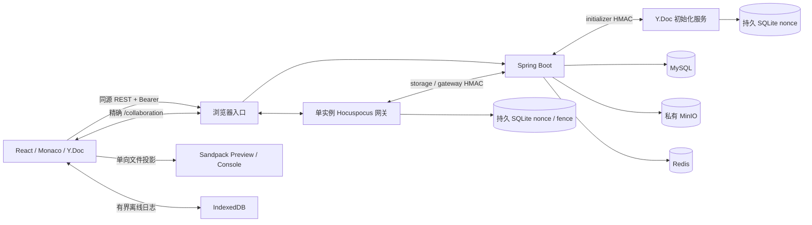

# V2 当前架构

截至 2026-10-08，步骤 01–11 及前端职责拆分已实施。本文描述当前模块与数据边界；阶段记录见 [V2 索引](README.md)，业务决策见 [总方案](00-overall-plan.md)。

## 系统组成

本机完整入口由 `release-edge.mjs` 提供，分进程开发使用 Vite，生产候选使用 nginx 模板。浏览器通过同源路由访问 REST 与 WebSocket，`/internal/` 不对外开放。API、网关及初始化服务在完整本机启动器中只监听 loopback；生产配置也必须保持该边界。

## 模块职责

| 模块 | 主要实现 | 职责 |
| --- | --- | --- |
| 应用装配与路由 | `frontend/src/V2App.tsx`、`app/` | 主题、BrowserRouter、认证守卫、带资源 key 的路由入口、公共壳与面包屑 |
| 身份、团队与邀请 UI | `frontend/src/features/auth/`、`teams/`、`invitations/` | 页面组合与导航、业务数据 Hook、成员/审批/邀请/项目面板；凭据只在内存 |
| 项目 UI 与共享表单 | `frontend/src/features/projects/`、`ui/Metadata*` | 项目详情、共享操作与按钮、初始化重试、元数据输入；按用户/项目/epoch 挂载工作区 |
| 请求与异步反馈 | `frontend/src/api/`、`hooks/useTask.ts`、`hooks/useAuthUser.ts`、`ui/errorMessage.ts` | 复用既有 API 与认证订阅；一页一份操作 busy 和错误展示，权限清理由页面执行器处理 |
| 协作会话 | `frontend/src/collaboration/` | 票据、Provider、授权状态、离线日志、Presence 与持久化确认 |
| 编辑与预览 | `frontend/src/editor/v2/` | fileId 模型、Monaco 绑定和语言 worker、文件结构命令、Sandpack 投影 |
| REST 与授权 | `backend/.../identity/`、`team/`、`common/security/` | JWT、刷新、实时成员校验、OWNER 管理边界 |
| 协作持久化与控制 | `backend/.../collaboration/` | 初始化、当前指针 CAS、删除 fence、Outbox、清理、备份与恢复 |
| 编码服务与网关 | `collaboration/src/` | Y.Doc schema、Update 校验、Origin/票据握手、自动 flush、控制水位 |
| 本机与运维工具 | `collaboration/scripts/` | 启动、功能验收、发布打包校验、指标、联合备份与恢复 |

表内 backend 路径相对 `backend/src/main/java/com/webeditor/`。旧 V1 UI 与保存组件保留用于回归测试，不进入 V2 生产编辑链路。

## 前端依赖与生命周期

`V2App → app → features 页面 → 业务 Hook/组件 → api/types/ui`。共享模块不引用页面；项目操作不引用团队页面。`AppShell` 继续由各页面挂载，页面切换重置顶部栏折叠状态。认证守卫只读取内存身份，不增加会话恢复或回跳规则。

`useTeamDetails` 是团队基础与所有者管理数据的一份快照。所有 reload 共用取消控制与递增请求序号；写入基础、管理及错误数据前核对序号和身份。失去所有者身份清空审批/邀请，旧响应不能恢复它们。列表、发现与邀请 Hook 清理请求及防抖，按身份和查询参数识别有效结果。

`useProjectActions` 注入页面 busy 与执行器，编辑、复制、删除、重试及成功后刷新处于同一次任务中。团队执行器保留 USER_NOT_FOUND 例外；详情执行器遇到 403/404 返回团队列表，删除成功则返回所属团队。元数据摘要合并保留 collaboration；工作区继续懒加载，key 为 userId/projectId/epoch。头部提供当前会话导出的 portal 挂载点，列表导出仍动态加载独立流程。

样式从 `styles.css` 按原顺序导入基础、页面、工作区与后续覆盖规则。旧界面、共享交互、Ant Design 控件及响应式规则保留独立分组，避免在归类时改变级联。实施及验证记录见[前端重构](../frontend-refactor/README.md)。

## 数据归属

| 数据 | 权威位置 | 约束 |
| --- | --- | --- |
| 用户、密码摘要、token/authz 水位 | MySQL `app_user` | JWT 验证后复核当前 token 水位 |
| 团队、成员、申请、站内邀请 | MySQL 团队表 | OWNER 仅管理成员；有效成员对项目同权 |
| 项目归属、名称、状态、锁版本 | MySQL `project` | 元数据更新/删除使用独立 stateVersion 与 If-Match |
| 当前文件正文与结构 | 房间 Y.Doc；持久副本在 MinIO | Y.Text 与稳定 fileId 是编辑事实源；Sandpack 不回写 |
| 当前持久化水位 | MySQL `collab_document` | 每项目唯一 epoch/generation/hash/size/objectKey 指针 |
| 持久化回执、对象保护、票据与内部 nonce | MySQL 协作表 | 幂等、CAS、上传租约、备份保护与票据单用 |
| 删除与撤权事件、恢复操作 | MySQL `collab_operation`、`collab_control_event`、`collab_recovery` | 事务提交、可靠 Outbox、失败时持续 fence |
| 刷新凭据摘要与登录节流 | Redis | 不承载协作广播或源码 |
| Node 接收 nonce、网关 fence/事件水位 | 接收端 SQLite | 跨重启保留，正常升级不能清除 |
| 客户端离线更新 | IndexedDB `web-editor:{userId}:{projectId}:{epoch}` | 1.5 MiB 待确认预算，无身份凭据，重连重新授权 |
| Presence 与远端选区 | Awareness 内存 | 服务端绑定用户与 connectionId，不入文件持久化 |

Y.Doc schemaVersion=1 包含 `meta`、`files` 和 `fileOrder`。对象路径为 `collab/projects/{projectId}/epochs/{epoch}/{generation}-{hash}.yjs`；先上传不可变对象，再 CAS 切换指针。`generation` 是持久化序号，`epoch` 隔离旧文档，两者都不是用户历史版本。

文件管理扩展增加可选根映射 `directories: Y.Map<path, true>`，用于保存空目录并避免首次并发创建丢失目录。浏览器、网关和初始化服务同步支持该映射，并沿用原有指纹、持久化、复制及离线日志链路；详见[文件管理交互](file-explorer.md)。已有目录数据的文档不能回滚到不支持该扩展的旧服务。

Flyway 迁移已落地至 V13：V1/V2 保留旧快照表与约束；V3 元数据锁；V4/V5 身份水位；V6–V9 团队与邀请；V10 当前协作存储；V11 票据/nonce；V12 删除/Outbox；V13 恢复。只追加迁移，不改写已发布脚本；步骤 11 没有新增认证切换迁移。

## 安全与故障边界

REST 从启动起强制认证，公开注册、登录、刷新、发现和健康检查按安全链开放。授权按数据库当前团队关系查询，不使用 JWT 中的项目角色。刷新凭据与 JWT 不写浏览器持久存储；票据只经 WebSocket 认证消息传递，不放 URL。

网关先校验精确 Origin，再消费单次票据并复核 epoch 与授权水位；最长 5 秒写入授权租约及 Outbox 关闭旧权限连接。Update 在广播前用临时 Y.Doc 校验，文件/文档/pending/连接/RSS 均有硬上限。内部 HMAC 按 storage、gateway、initializer、maintenance 分开密钥和 audience，nonce 持久化防重放。

持久化失败保留 pending 并暂停写入；CAS 冲突只在同 epoch 合并重试，旧 epoch 拒绝。删除先 fence/flush 再提交数据库；未确认 durable-close 不完成删除。进程突然崩溃可能丢失只在内存的更新，客户端日志在重新授权后重发。当前文件恢复使用配套 MySQL/MinIO 备份，重建新 epoch；不提供 V1 revision 回退或已删除项目恢复。

首期单网关，不含多实例广播、项目 Viewer、平台管理员或用户版本控制。容量与运行说明见 [开发指南](development.md)，详细故障处置见 [运维说明](step10-operations.md)。
