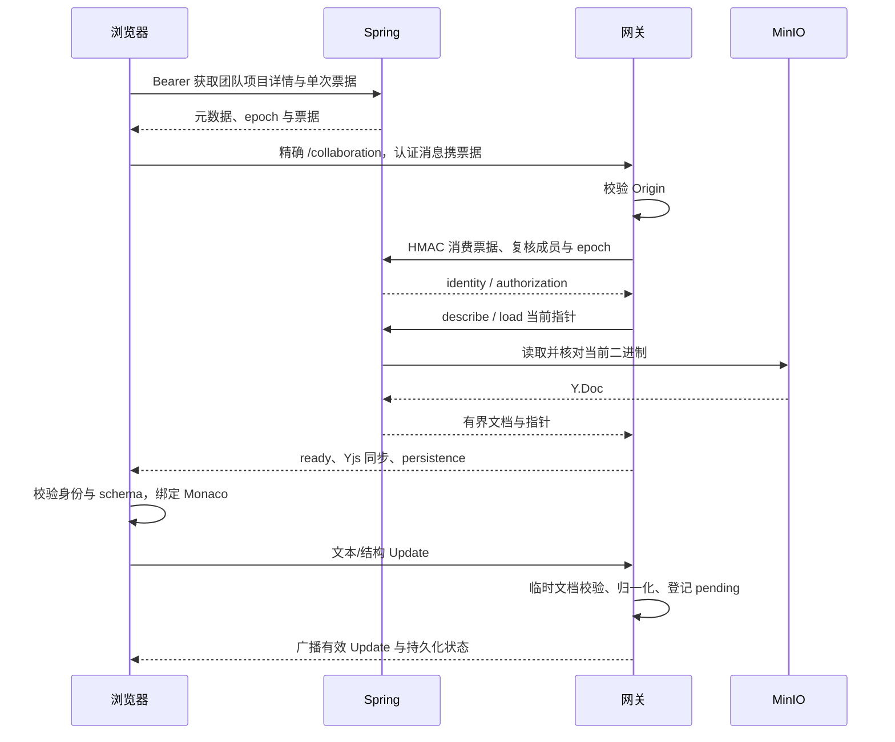

# V2 当前数据流

本文描述最终 V2 行为。模块与数据归属见 [架构](architecture.md)，内部签名及消息字段见 [协作模块](../../collaboration/README.md)。

## 登录与项目初始化

注册创建 MySQL 用户，注册后显式登录。登录返回短期 JWT 与 opaque 刷新凭据；Redis 只保存刷新摘要与 family，浏览器只保存内存会话。REST 请求携带 Bearer，服务端验证 JWT、当前 token 水位和资源授权；刷新凭据单次轮换。页面重载后重新登录，离线日志不包含登录凭据。

有效成员创建项目时，Spring 保留 INITIALIZING 项目 ID，通过内部 HMAC 请求受信编码服务生成模板 Y.Doc。核对身份、schema、hash 和大小后，事务外上传 MinIO，再原子激活项目与 generation=1 指针。初始化失败记录不进入项目列表/详情；客户端用 `X-Initializing-Project` 重试同一个 ID。复制先 flush 源房间，再从当前权威文档生成新的项目身份；flush 失败不创建副本。

## 页面查询与元数据操作

`AppRoutes/RequireAuth` 按既有内存身份分流，TeamRoute/ProjectRoute 用资源 ID 的 key 隔离页面状态。团队基础数据并行加载，确认当前用户为所有者后才加载申请和邀请；每次 reload 取消并使旧代次失效，迟到基础数据、管理响应及错误不会覆盖当前快照。列表与搜索保留独立的身份、查询及分页标记。

页面唯一 `useTask` 经团队/项目执行器注入 `useProjectActions`，API 操作和成功后刷新都 await 在任务内，所有同页业务按钮保持锁定。元数据对话框只收集名称/描述；创建团队保留原始字符串与空描述，项目创建由调用方转换为空值，编辑提交规范化值。失败保留草稿，取消不请求。

更新 API 返回项目摘要，详情 Hook 合并到现有详情并保留 collaboration，后续编辑/删除使用最新 stateVersion 的 If-Match。名称/描述更新只改变工作区 props；用户、项目或 epoch 改变才替换会话。详情头部导出入口由当前工作区 portal 提供，团队列表的动态导出仍走独立会话流程。

## 打开与编辑

每个 fileId 绑定稳定 Y.Text。文本输入与补全写 Y.Text，文本 undo/redo 不撤销远端或结构命令。文件创建、重命名、逻辑删除和入口切换使用原子 transaction；同路径冲突按稳定 fileId 确定性归一化。入口以 Y.Doc 的 entryFileId 为准，REST `entry` 仅是创建时元数据。

Y.Doc 单向派生文件树、Monaco 和 Sandpack；预览文件 300 ms 防抖、最长 1 秒更新，结构/入口改变重建运行环境。预览补丁不写回文档。Awareness 显示服务端绑定的在线身份与相对光标，不保存源码或历史。

## 自动持久化

网关每房只有一个保存任务，1 秒防抖、最长 5 秒触发；离房、复制和正常停机也 flush。保存先通过 Spring 上传不可变 Y.Doc 对象，再按预期 epoch/generation CAS 切换 MySQL 指针并递增 generation。回执丢失使用相同业务幂等键对账；同 epoch CAS 冲突重载权威状态、按序重放 pending 并校验重试。MinIO I/O 不包在数据库事务中。

| 状态 | 含义 |
| --- | --- |
| 已同步 | WebSocket/Yjs 同步状态，不代表已落盘 |
| pending | 已接受但当前内容尚未确认持久化 |
| durable | 当前指纹匹配，durableSequence 覆盖 dirtySequence；才显示已持久化 |
| failed / paused | pending 保留，暂停写入，退避重试 |
| forbidden | 权限、项目或 epoch 失效；关闭并清理相应内容/缓存 |

`contentHash` 是对象二进制 hash；acceptedHash/durableHash 根据规范内容和 CRDT clocks 确认客户端状态，避免 GC/undo tombstone 差异误报。保存仅更新当前指针，不创建 revision 或检查点。

## 离线与重连

有效会话断开协作传输后在有界日志内继续文本和结构编辑，Sandpack 使用本地文档；首次运行依赖仍需可用。日志按 userId/projectId/epoch 隔离，正常离房保留。刷新后须重新登录，重连先申请新票据并复核授权，再合并同 epoch 更新；确认指纹匹配后才清零待确认计数。无可验证会话、缓存写失败或容量超限时暂停；不支持完全离线登录。

撤权与永久删除清理相关日志、模型和文档，旧 epoch 不自动重放；临时维护 fence 暂停编辑并保留日志。远端删除与本地编辑冲突给出恢复为新文件或验证访问后复制的选择。

## 删除与撤权

删除要求强 If-Match。Spring 提交 PREPARED → 网关 fence 停止新 Update 并 flush → 返回 durable-close ACK → Spring 按 project → collab_document 锁顺序复核水位并原子软删除、推进 epoch、提交 operation 和 PROJECT_DELETED → Outbox 最终关闭旧房。最后持久化对象保留，旧票据、连接、缓存不能继续写入。ACK/提交结果未知保持 fence，由对账器确认 finalize 或安全 ABORT；租约过期不自动放开。

退出所有设备、改密、退出团队和移除成员在授权事务更新水位并写撤权事件。新 REST/票据按当前关系立即拒绝，网关收到 Outbox 后关闭受影响用户旧连接；当前水位为用户级，其他有效成员仍可编辑。至少一次投递按聚合水位幂等，最长 5 秒授权租约兜底。

## 联合备份与恢复

停写并 drain 后启用受控维护模式，登记所有当前对象的保护引用，校验并导出二进制，再导出配套 MySQL 并复核指针稳定；最后生成 manifest。备份包括软删除项目的保留对象，但不恢复该项目。

隔离环境恢复配套数据库/对象，隔离 Redis namespace 并轮换 JWT。受信编码器把每个活动项目当前内容重建为 epoch+1、generation=1，上传回读后原子切换指针并提交恢复操作。失败保持原指针与持续 fence，同一 operation ID 可重试；旧缓存不得跨 epoch 重发。完整操作见 [运维说明](step10-operations.md)。
