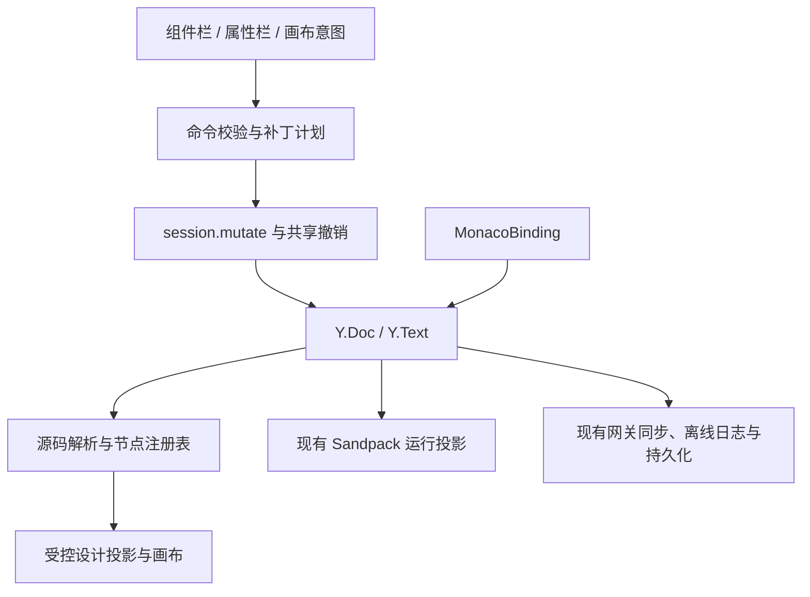

# V3 技术约束与实施路线

日期：2026-10-10。状态：架构评审建议，不是已实现设计。功能范围见[需求规格](requirements.md)。

2026-10-12 补充：[技术评审](technical-review.md)细化补丁执行、共享历史、并发 CSS 引用、画布隔离及恢复方案；实施阶段以前置 P0 门禁和该文档修订顺序为准。用户已确认本机持久恢复、保留现有离线编辑，以及冲突提示与人工恢复；不要求任意并发移动自动语义合并，检测及恢复能力仍须验证。

## 现有实现与接入点

| 文件                                                                                                                            | 已核实事实                                                          | V3 建议接入                                                |
| ------------------------------------------------------------------------------------------------------------------------------- | ------------------------------------------------------------------- | ---------------------------------------------------------- |
| [ProjectWorkspace.tsx](../../frontend/src/editor/v2/ProjectWorkspace.tsx)                                                       | 挂载文件树、Monaco、Sandpack，读取 session 状态                     | 新增组件栏、属性栏、设计目标及模式切换                     |
| [projection.ts](../../frontend/src/editor/v2/projection.ts)                                                                     | 从 Y.Doc 派生运行文件，临时依赖不入权威文档                         | 保留运行投影，新增独立设计投影                             |
| [SandpackBridge.tsx](../../frontend/src/editor/v2/SandpackBridge.tsx)                                                           | 跨 origin 运行预览，300 ms 防抖、最长 1 秒更新，iframe 已有 sandbox | 保留完整运行能力，不以父页面直接读取 Sandpack DOM 实现编辑 |
| [session.ts](../../frontend/src/collaboration/session.ts)                                                                       | mutate 先临时文档预检再提交，undo 同样预检；可写不等于必须在线      | 共用写入和撤销门禁，增加可视化 origin                      |
| [MonacoWorkspace.tsx](../../frontend/src/editor/v2/MonacoWorkspace.tsx)                                                         | UndoManager 当前在组件内创建且只跟踪 MonacoBinding                  | 提升为会话/工作区共享撤销管理，定义跨文件分组              |
| [document.ts（前端）](../../frontend/src/collaboration/document.ts)、[document.ts（网关）](../../collaboration/src/document.ts) | 严格校验根字段、文件字段、纯文本和 schemaVersion                    | 首期维持 schema，节点映射留在本地派生缓存                  |
| [htmlDiagnostics.ts](../../frontend/src/editor/v2/htmlDiagnostics.ts)                                                           | HTML 扫描诊断，不是完整源码映射模块                                 | 新增带位置的 HTML 解析模块，与既有诊断分工                 |
| [document-rules.ts](../../collaboration/src/document-rules.ts)                                                                  | 文件白名单不含 JSX/TSX 或图片二进制，容量规则前后端共享             | 不隐式扩展框架源码和素材存储                               |

parse5 不在当前前端直接依赖中，需新增并验证浏览器构建、worker、容错与源码区间能力；不能称作已有模块。其源码位置选项可提供节点区间，自动补出的节点可能无位置。[官方文档](https://parse5.js.org/interfaces/parse5.ParserOptions.html)

## 数据流与模块建议

组件模板引入固定版本 Bootstrap，依赖规划模块 `bootstrapDependencies` 与模板注册表协同生成 CSS/许可/link/HTML 的原子 PatchPlan。设计投影和 Sandpack 都读取项目依赖文件，不只为画布注入样式；详见[Bootstrap 依赖方案](bootstrap-dependency.md)。资源预算、并发首次创建与引用、撤销依赖保护加入 P0。

建议新增 `frontend/src/editor/visual/`，分别管理模板注册、parser/registry、commands/patches、design projection/bridge、拖拽命中与属性面板；目录仅为实施建议。底层解析与补丁尽量独立于 React，UI 只生成操作意图。

不得直接新增 Y.Doc 顶层 `designTree` / `nodeMap`、文件元数据字段或带 attributes 的 Y.Text。现有 schema 只允许 `meta/files/fileOrder/directories`，meta 与文件记录均有固定字段数。后续若扩展共享模型，必须同时评审前端、网关、离线缓存、导入导出和兼容升级。

## 节点映射与源码补丁

节点记录至少包含 projectId、epoch、fileId、源码解析版本、画布 generation、临时 nodeId、节点类型、起止位置、必要的父子上下文和相对锚点。nodeId 仅在对应投影中有效，文件重命名仍依靠稳定 fileId 定位。

源码修改采用插入、移动、删除、文本和属性修改命令。命令包含请求 ID、模板 ID/版本或操作类型、涉及文件、预期源片段/上下文、目标父节点与相邻节点，以及无重叠的补丁列表。同一文件补丁按源码偏移倒序应用；移动先在未修改快照中计算删除与插入，正确处理前移/后移、缩进和相邻注释归属。禁止全文件 DOM 序列化或自动格式化。

提交过程必须完成：

1. 验证当前身份、epoch、可写状态、设计目标、画布代次及请求去重。
2. 读取最新 Y.Text，解析并核验目标、源片段、属性旧值和父子关系；旧解析编号不能直接当最新节点。
3. 预先生成组件实例 class、所需文件 ID 和其他随机值，确定全部文件补丁及资源引用。
4. 在一次 `session.mutate(action, VISUAL_ORIGIN)` 中预检并提交，之后才更新通知和 UI。拒绝、取消和失败均无源码变化或空撤销记录。
5. 基于新内容重新解析和投影；如果远端合并造成歧义，暂停受影响设计操作并提示源码处理。

`mutate()` 会分别在 scratch 和 live 文档执行 action，因此 action 必须同步、确定性、无外部副作用。通过参数 doc/fileId 重新取 Y.Text，不能捕获 live Y.Text；UUID、时钟、网络请求、通知和日志不放入 action。关联文件创建也要支持预先指定稳定 ID，不能直接复用会在闭包内部重新随机生成 ID 的命令。

Yjs transaction 本身不提供异常回滚保证。补丁计划必须预先完整验证；live action 内避免在部分写入后才抛出异常，并通过失败路径验收证明不留下半个组件。

## 协作、失效与撤销

相对锚点能跟随远端文本插入，但仍需核验节点语义；位置解析可能失效。[Y.RelativePosition 文档](https://docs.yjs.dev/api/relative-positions)

| 场景                                        | 要求的策略                                                                                               |
| ------------------------------------------- | -------------------------------------------------------------------------------------------------------- |
| 前方无关文本变化                            | 重新解析，用锚点及上下文唯一定位后允许提交                                                               |
| 目标删除、替换、分裂或父结构变化            | 不沿旧偏移写入，取消/刷新映射并提示重试                                                                  |
| 属性提交前原值已变                          | 提示冲突，不自动覆盖未被用户看到的新值                                                                   |
| 同一点同时插入                              | 接受既有文本 CRDT 顺序，重新解析验证结果并显示实际顺序                                                   |
| 两人同时移动/删除子树、移动期间源片段被修改 | 客户端预检无法排除尚未收到的更新；合并后检测结构歧义，限制相关设计操作并保留恢复内容，禁止无提示全量回滚 |
| 离线编辑后重连                              | 同步已经提交的 Yjs 更新，复核授权/epoch 后重建映射；不持久化并重放旧拖拽意图                             |
| 项目、epoch、设计文件或模式变化，画布重载   | 清理旧选择、拖拽、请求、worker 结果和消息；重命名可跟随 fileId，但重新建立资源投影                       |

文本 CRDT 收敛不能证明移动语义正确，也不能证明原片段同时新增的内容被完整搬移。若验证无法满足[验收矩阵](acceptance.md)中内容保留与恢复要求，必须在开发前调整冲突机制，例如新增带版本条件的网关语义命令或结构互斥；不能仅把失败归入“Yjs 已收敛”后继续交付。此项是技术门禁，不是本次已经选择新增锁协议。

共享 UndoManager 跟踪本地 MonacoBinding 和 VISUAL_ORIGIN，每次拖拽/删除等离散命令前后切断 capture 分组；属性连续输入有明确合并边界。代码面板、画布工具栏和快捷键使用同一操作序列，并经 `session.undo()` 校验。

当前 UndoManager 及 `session.undo()` 的 scratch preview 均只覆盖 `files`；创建 CSS 还会修改 `fileOrder`。必须同步扩展真实管理器与 scratch 预检 scope，至少覆盖 `files` 与 `fileOrder`，若命令涉及目录/meta 也须纳入相同范围，保证撤销后 schema 有效。新增文件、HTML 内容、link 与 CSS 修改一起分组；纳入结构根时仍须区分来源，不能把既有其他文件命令无意混入历史。

新增 CSS 文件未被其他成员修改或引用时，可以整体撤销创建；若已包含远端贡献或新引用，不能无条件删除整个文件。必须保留其身份及内容，按本地贡献安全补偿，或拒绝本次整体撤销并解释原因。安全补偿也须完整预检；不能借整份旧文件覆盖恢复。AC-11 专门覆盖“甲创建 CSS、乙编辑/引用、甲撤销”。

## 设计画布与通信边界

建议独立受限 iframe 渲染静态设计投影，Sandpack 留作运行模式。项目内 CSS 及相对引用必须解析到受控资源，清理对象 URL；外部资源失败可提示但不能修改原源码。工具属性只注入投影副本，命名冲突需隔离，不能按属性名直接信任用户 DOM。

设计环境既要阻止 script，也要处理内联事件、危险 URL、SVG 执行入口、表单提交、链接导航和 iframe/object/embed；禁用内容只作用于设计投影，不改写项目源码。受控脚本授权与 CSP、资源允许策略需专项验证，不能用“移除 script”证明禁止 JS。设计 iframe 不获得父页面认证令牌或存储访问能力。

父页面与画布可用 postMessage/受控消息通道通信，跨 origin 无法直接读取对方 DOM。[MDN 文档](https://developer.mozilla.org/en-US/docs/Web/API/Window/postMessage)

桥接协议至少包含 protocolVersion、channel、canvasGeneration、requestId、消息类型及有界 payload。核验预期 source 窗口、可验证的精确 origin、会话标识与当前项目身份；opaque-origin 场景不能把 `null` 当认证，须用来源窗口和不可复用的握手能力。会话标识是桥接辅助校验，不是对同 iframe 中恶意脚本的安全隔离，脚本限制仍是前提。

画布只能报告 ready、选择、元素几何、命中和插入意图；不能提交任意文件路径、源码补丁或父页面可执行代码。父层依据受信模板和当前源码生成操作，所有写入口包括快捷键都受统一门禁控制。坐标协议明确父/子视口、缩放、滚动、插入前后语义；跨 iframe 拖拽必须先验证，不能假定 React 拖拽库自动覆盖。

## 实施阶段及门禁

| 阶段              | 交付工作                                                 | 进入下一阶段的证据                                                           |
| ----------------- | -------------------------------------------------------- | ---------------------------------------------------------------------------- |
| P1 源码与画布基础 | 解析/映射、桥接、源码定位、组件栏按钮拖入、局部补丁      | 跨 iframe 插入准确；未改区间不变；双客户端与持久化闭环可验证；命令双执行安全 |
| P2 组件与属性     | 完整基础组件库、复合组件 CSS、多页面、文本/属性/样式面板 | HTML/CSS 引用和实例隔离正确；输入编码及取消无误；全部模板可拖入              |
| P3 结构与历史     | 排序、跨容器移动、删除/复制、统一跨文件撤销重做          | 非法目标拒绝；移动保留子树；离散操作分组；代码/画布历史顺序一致              |
| P4 协作与完整交付 | 并发恢复、离线、容量、权限、运行回归、导出、键盘和性能   | 全部验收项有可复核证据；风险门禁关闭；本机服务完整验证                       |

阶段安排不能删除完整范围。P1 原型成功仅证明关键链路，不能标记 V3 完成。新增库、存储协议或数据库迁移须基于验证结果决定，本次未承诺需要后端 schema 变化。
