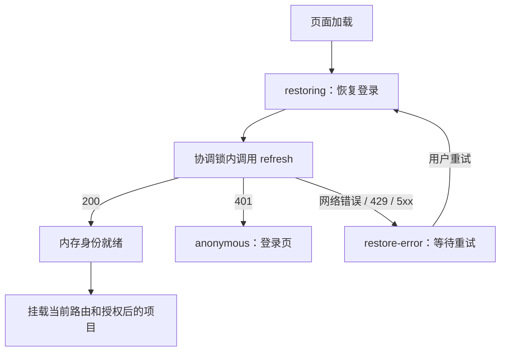

# 浏览器登录会话恢复开发方案

日期：2026-10-07；交付更新：2026-10-08。状态：开发完成，本机服务与 Chrome 多标签页验收通过。实际检查范围、事务/故障边界及部署环境待检查项见 [验收记录](verification.md)。

采用 HttpOnly Cookie 保存刷新令牌，访问令牌与用户资料仅保留在页面内存。页面刷新后先恢复会话，再进入原有路由。沿用现有 JWT、Redis 令牌族、原子轮换、重放检测与用户版本撤销机制。

## 1. 范围与体验

- 登录后刷新团队页或项目页，在会话有效时留在原地址，无需重新输入账号密码。
- 同一浏览器、同一站点的新标签页可以恢复当前登录身份；不同账号不支持在同一 Cookie 作用域的标签页中并存。
- 关闭浏览器后重新打开，在 Cookie 与服务端会话仍有效时可恢复身份。
- 保留当前默认时限：访问令牌 10 分钟、刷新空闲超时 30 分钟、令牌族最长 12 小时、每用户最多 5 个令牌族。这里只改变保存与恢复方式，不增加长期“记住我”。
- 空闲以成功刷新活动计算，鼠标、键盘和协作 WebSocket 消息不续期。连续编辑但没有刷新请求超过 30 分钟，重新加载仍可能要求登录；不承诺消除正常到期、会话淘汰、撤权或响应丢失造成的重新登录。
- 有效身份下退出登录和修改密码继续撤销该账号的所有已有会话；当前浏览器各标签页及时清理身份与协作连接，其他浏览器通过既有版本校验与撤权链路失效。退出时身份已不可验证，只能确认本机匿名，不能宣称其他设备已退出。
- 网络中断或服务暂不可用时显示恢复失败与重试入口；不直接认定用户已经退出，不清除离线编辑缓存。

本次不改为 Spring HttpSession，不增加 SSO/BFF，不支持浏览器跨站部署，也不改变团队、项目、协作票据的授权规则。登录恢复不能替代项目重新授权。

## 2. 改造前基线与改造位置

| 位置 | 改造前行为 | 本次改动 |
| --- | --- | --- |
| [前端认证](../../frontend/src/api/auth.ts) | 凭据全部在内存，刷新依赖内存 refreshToken；任何刷新失败清理身份 | 删除前端 refreshToken；增加启动恢复、状态机、错误分类及会话协调 |
| [前端请求](../../frontend/src/api/client.ts) | Bearer + credentials: omit；刷新异常会清理身份 | 保留业务请求策略，区分刷新暂时失败和确定失效，最多重试业务请求一次 |
| [路由与认证守卫](../../frontend/src/app/AppRoutes.tsx)（[RequireAuth](../../frontend/src/app/RequireAuth.tsx)） | user=null 立即跳登录 | 恢复完成前阻止受保护页面挂载和重定向 |
| [前端类型](../../frontend/src/types/auth.ts) | Credentials 含 refreshToken | 浏览器类型仅包含 user、accessToken、expiresIn |
| [协作会话](../../frontend/src/collaboration/session.ts)与[离线缓存](../../frontend/src/collaboration/offline.ts) | 身份代次变化触发 forbid 和缓存清理 | 临时认证故障保留身份代次及离线队列；确定失效才走撤权清理 |
| [登录过滤器](../../backend/src/main/java/com/webeditor/common/security/JsonAuthenticationFilter.java) | 直接序列化 AuthService.Credentials | 写入 Cookie，序列化独立的浏览器响应 DTO |
| [JWT 过滤器](../../backend/src/main/java/com/webeditor/common/security/JwtAuthenticationFilter.java) | logout 强制 Bearer；数据库等异常统一返回 401 | 精确跳过 POST logout；凭据无效 401、依赖不可用 503，避免错误清理身份 |
| [异常处理](../../backend/src/main/java/com/webeditor/common/exception/GlobalExceptionHandler.java)与[安全错误](../../backend/src/main/java/com/webeditor/common/security/SecurityErrors.java) | Redis 连接错误有 503，其他未分类异常为 500 | 统一认证依赖故障与轮换结果不确定的错误码，覆盖 no-store |
| [认证控制器](../../backend/src/main/java/com/webeditor/identity/controller/AuthController.java) | refresh 从 JSON 读取令牌；logout 要求 Bearer | refresh 从 Cookie 读取；logout 支持 Cookie 恢复身份后撤销，成功清 Cookie |
| [认证服务](../../backend/src/main/java/com/webeditor/identity/application/AuthService.java) | 生成含明文刷新令牌的内部凭据；logout 递增版本 | 分离内部签发结果与公开响应；增加不轮换的刷新会话校验/撤销入口 |
| [刷新存储](../../backend/src/main/java/com/webeditor/identity/application/RefreshStore.java) | Lua 单次轮换，重放删除令牌族 | 保留重放语义；返回内部有效期元数据，支持注销时校验会话 |
| [安全配置](../../backend/src/main/java/com/webeditor/common/security/SecurityConfig.java) | 无状态，关闭 CSRF/CORS，注册过滤器 | 在登录前接入精确来源校验过滤器，明确 Cookie 接口边界 |
| [配置](../../backend/src/main/resources/application.yml)与[模板](../../.env.example) | JWT/Redis 配置已有 | 增加 Cookie 安全配置与认证来源白名单 |

登录实际由 JsonAuthenticationFilter 处理，不能仅修改 AuthController。新增安全过滤器应关闭 Servlet 自动注册，明确在 Spring 安全链中的执行顺序，避免执行两次。

POST logout 必须同时加入 SecurityConfig 的匿名入口和 JwtAuthenticationFilter 的 shouldNotFilter 精确匹配。其他方法、password 和业务 API 仍走 Bearer 校验。数据库查询失败不能落入“无效 JWT”的兜底 catch；认证失败与依赖故障分别处理，过滤器层的异常不能依赖 ControllerAdvice 兜底。

## 3. 凭据边界与 Cookie

| 数据 | 保存位置 | 允许对外传递的位置 |
| --- | --- | --- |
| accessToken | 前端模块内存 | 登录/刷新响应 JSON，业务 Authorization 头 |
| refreshToken | 浏览器 HttpOnly Cookie；Redis 仅以摘要索引 | 后端 Set-Cookie 和浏览器 Cookie 请求头 |
| user、expiresAt | 前端内存 | 公开身份响应 |
| 跨标签页会话标记 | 同源 localStorage，仅非敏感随机标记和退出待确认状态 | 本地协调；不作为服务端授权依据 |

JWT、刷新令牌、密码和协作票据不得进入 localStorage、sessionStorage、IndexedDB、URL、日志、BroadcastChannel 消息或 Sandpack iframe。内部签发结果含刷新令牌，但必须通过专用 DTO 输出，不能依靠前端忽略字段来保密。

Cookie 统一由后端组件创建和删除，建议名为 `web_editor_refresh`：

本机多个 Vite 前端实例按实际监听端口隔离浏览器 Cookie，例如 `web_editor_refresh_5173` 和 `web_editor_refresh_5174`。开发代理只把当前端口的 Cookie 改名为后端固定名称，其他端口以及旧共享 Cookie 不转发；响应中的签发与删除同步改名，安全属性不变。首次切换后各端口分别重新登录。同一端口的标签页仍共享身份与 Web Locks；不同端口可以使用不同账号。生产 nginx 不采用开发代理命名，继续使用固定 Cookie 契约。端口命名只隔离开发实例的会话选择，Cookie 本身仍按主机作用域发送。

| 属性 | 目标值 |
| --- | --- |
| HttpOnly | true，固定不可关闭 |
| Secure | 生产 true；本机 HTTP 开发显式设为 false |
| SameSite | Strict；当前仅支持同源页面与 API |
| Path | /api/auth，涵盖 refresh、logout、password |
| Domain | 不设置，使用 host-only Cookie |
| Max-Age | 当前刷新令牌空闲剩余时间与令牌族剩余时间的较小值，向下取整秒 |

刷新成功后写入新的 Cookie，并更新剩余时间；令牌族绝对到期时间不得向后延长。Redis 的实际校验优先于浏览器 Cookie。内部签发结果需携带空闲截止时间与令牌族截止时间，或等价剩余寿命，首次登录与轮换都按同一规则计算。

删除 Cookie 必须使用相同的 name、Path 和 Domain，并设置 Max-Age=0，保留对应环境的安全属性。发现同名重复 Cookie 时拒绝认证，避免采用不确定的解析顺序。当前 Path 不符合 `__Host-` 前缀的 Path=/ 要求，不能直接加该前缀。

Path 只控制浏览器发送范围，不是 XSS 安全隔离。HttpOnly 阻止脚本直接读取刷新令牌，但 XSS 仍能借当前页面身份调用接口；编辑预览继续采用既有 iframe 隔离。[Cookie 属性参考](https://developer.mozilla.org/en-US/docs/Web/HTTP/Reference/Headers/Set-Cookie)

## 4. 接口契约

统一沿用项目 ApiResponse 包装和既有错误格式。登录/刷新响应的 `data` 为：

```typescript
interface BrowserCredentials {
  user: User
  accessToken: string
  expiresIn: number // 访问令牌剩余秒数
}
```

| 接口 | 请求 | 成功 | Cookie 与身份规则 |
| --- | --- | --- | --- |
| POST /api/auth/register | 现有注册 JSON | 201，公开用户信息 | 不建立登录会话 |
| POST /api/auth/login | 保留现有严格的 {login,password} | 200，BrowserCredentials | 设置刷新 Cookie；登录失败不清除原有有效 Cookie |
| POST /api/auth/refresh | application/json，严格空对象 {} | 200，BrowserCredentials | 仅从 Cookie 读取，原子轮换并设置新 Cookie；拒绝旧 JSON refreshToken 字段 |
| GET /api/auth/me | Bearer，credentials: omit | 200，用户资料 | 不以刷新 Cookie 认证业务请求 |
| POST /api/auth/logout | application/json，{}；不要求访问令牌 | 200，LogoutResult | 有效刷新 Cookie 对应账号全部撤销提交后返回 revoked；缺失或失效返回 local-only；两者都清 Cookie |
| PUT /api/auth/password | Bearer + 现有密码 JSON | 204 | 成功修改并撤销所有会话，清 Cookie；密码校验失败不删除仍有效 Cookie |

logout 路径可通过安全链的匿名入口，但业务层必须校验来源并校验刷新会话，绝不能仅因路径公开就跳过身份验证。校验刷新会话不签发新令牌，也不为注销先执行一次轮换；对已用令牌仍执行重放撤销规则。对有效会话校验、读取用户版本和用户撤销的并发行为需有集成测试。

LogoutResult 使用 ApiResponse 包装，data 为 `{ outcome: 'revoked' | 'local-only' }`。revoked 仅表示本次已确认该账号全会话撤销提交；local-only 不说明其他设备状态，也不能推断先前请求是否成功。对已撤销会话的重复退出可以返回 local-only，客户端不能据此补写全设备退出成功。需要确认其他设备退出时，用户重新认证后再显式执行退出；普通重新登录本身不代表撤销其他设备。

refresh 的 401 表示缺失、格式无效、过期、重放或用户版本失效，返回统一认证错误并清 Cookie。来源校验失败 403、格式错误 400、限流 429 在轮换前返回，不清 Cookie；429 保留 Retry-After。Redis/数据库暂不可用返回 503，但必须按第 8 节区分提交前故障 AUTH_SERVICE_UNAVAILABLE 和提交结果不确定 AUTH_REFRESH_OUTCOME_UNKNOWN，不能保证所有 503 都未轮换。两类 503 都不发送 Cookie 删除指令；结果不确定不自动重试。logout 遇到服务不可用或撤销提交不确定必须返回 503，不能假报服务端已撤销。

登录、刷新、退出、修改密码及 me 的认证响应（含错误）设置 Cache-Control: no-store。错误写入器和安全过滤器中的提前返回也需覆盖。刷新接口的 8 KiB 请求限制保留，并将 logout 纳入认证请求体限制。

## 5. CSRF 与同源部署

本期选择“精确 Origin 白名单 + 自定义请求头 + 同源访问”的 API 防护方式。Cookie 会自动发送，不能只靠 HttpOnly 或 SameSite；该方案基于 OWASP 的来源校验与自定义请求头建议，具体接口范围由本项目确定。[CSRF 参考](https://cheatsheetseries.owasp.org/cheatsheets/Cross-Site_Request_Forgery_Prevention_Cheat_Sheet.html)

- register、login、refresh、logout、password 的修改请求都必须携带 `X-Web-Editor-Request: browser` 和合法 Origin，且使用 application/json。
- 该头是请求来源防护标记，不是秘密或身份凭据；浏览器跨源发送它需要预检，服务端不开放跨源访问。
- 精确比较协议、主机、端口；拒绝缺失 Origin、Origin: null、多个值、非白名单来源及同站不同源的兄弟子域。禁止后缀匹配和通配符。
- 如 Sec-Fetch-Site 存在且为 cross-site，额外拒绝；不能把该头存在作为唯一验证依据。
- 来源校验必须早于登录签发、轮换及注销处理；CSRF 拒绝不得产生 Set-Cookie 或服务端会话变更。
- Spring 安全链保留 STATELESS。可以保留框架 CSRF 关闭，但必须由上述专用过滤器完整保护 Cookie 认证入口；不能只新增 Cookie 而维持无防护状态。
- 其他业务 API 继续只接受 Bearer，并固定 credentials: omit，不接受刷新 Cookie 代替访问令牌。内部 HMAC 与协作 WebSocket 的既有安全校验不变。

本机使用 Vite 的 /api 代理，生产使用 nginx 同源入口，前端仍请求相对 URL。认证 Cookie 接口使用 credentials: same-origin；不需要全局改为 include。password 为接收清 Cookie 使用 same-origin，但仍必须由 Bearer 认证。

公开页面 Origin 由部署配置提供，不能直接信任请求 Host 或客户端可伪造的 X-Forwarded-* 来构造白名单。代理应保留浏览器 Origin、Cookie、Set-Cookie，不缓存认证响应。后端继续仅绑定受控地址。Cookie 不按端口隔离，本机固定页面主机名，避免 localhost 和 127.0.0.1 混用。

## 6. 前端恢复与错误处理

认证状态显式区分：`restoring`、`authenticated`、`anonymous`、`restore-error`；退出失败另用 `logout-pending`。启动时默认 restoring，调用一次 Cookie refresh，不先跳登录。模块内共享恢复 Promise，防止 StrictMode 或重复挂载产生重复启动请求。



restoring/restore-error 时不挂载团队、项目和协作组件；保留当前 pathname、search、hash。恢复成功继续当前地址，失败登录后返回经校验的站内目标地址，拒绝外部 URL 与 // 开头地址。公开邀请页仍可展示公开内容，但任何授权动作等待恢复完成。

运行中延续访问令牌距过期不足 30 秒时按需刷新、业务 401 最多刷新后重试一次的机制。refresh 不再以“内存中存在凭据”为前置条件。不设无业务活动也持续刷新的定时器；本期空闲超时以服务端刷新活动定义。

登录 200 的 BrowserCredentials 已由服务端完成身份校验，前端校验响应结构后在锁内建立身份，不再将额外 /me 请求作为登录成功的前置条件。后续用户资料更新遇到网络或 503 不清身份，避免 Cookie 已签发而 /me 临时失败又触发缓存清理。

| 失败类型 | 前端处理 |
| --- | --- |
| refresh 401 | 清内存、关闭协作、清对应身份缓存，广播会话失效，进入登录 |
| 网络异常、refresh 429/5xx | 不清 Cookie/离线缓存；启动显示重试，运行中报告暂不可用，尊重 Retry-After |
| AUTH_REFRESH_OUTCOME_UNKNOWN 或刷新超时 | 提示刷新结果不确定，不自动重发；用户可手动重试或重新登录，并说明重试可能触发重放撤族 |
| Bearer 校验依赖故障 503 | 直接报告暂不可用，不按业务 401 刷新，不清身份与缓存 |
| 来源拒绝 403、协议错误 400 | 显示配置或协议错误，不无限重试，不作为账号失效处理 |
| 业务接口 403/404 | 继续既有资源授权处理，不全局认定用户已退出 |

重构 client.ts 中“catch 任意刷新错误就 clearAuth”的逻辑，并检查 refreshCredentials 的 catch。保留 generation/sessionGeneration，新增跨标签页身份标记检查；旧账号请求、退出前请求或状态切换后的迟到响应不得覆盖新身份。

运行中临时刷新失败保持 user、sessionGeneration 和跨页身份标记，向调用方抛出原始临时故障，不继续用首次业务 401 覆盖它，也不进入 clearAuth。已经挂载的工作区沿用离线规则；禁止因临时故障改成 restoring 并卸载工作区。启动 restore-error 时未挂载工作区，但已有 IndexedDB 数据仍保留。只有确认身份失效、退出、切换账号或资源撤权才清理对应身份/项目缓存；协作 session 的 forbid、导出限制和清理行为只接收这些确定事件。

## 7. 多标签页与轮换竞态

当前 Redis 轮换把旧令牌标记为 used，重放会撤销整族。页面内 refreshPromise 只能保护当前页面，不能保护其他标签页。因此跨标签页协调属于首期必做功能。

1. 同源标签页使用 Web Locks 的统一独占锁 `web-editor-auth-session`，串行执行 login、refresh、logout、password。锁覆盖完整 fetch 与响应解析，不能收到响应头就释放。
2. refresh 各标签页分别获取自己的访问令牌，锁内发请求时浏览器携带最新 Cookie；不通过消息广播 JWT。普通轮换不修改身份标记。
3. 登录切换、退出和确定失效在锁内更新非敏感会话标记，并通过 BroadcastChannel 与 storage 事件通知其他页。其他页立即清内存与旧协作连接；重新读当前标记，不仅依赖可能丢失的消息。
4. 等待锁的任务重新检查会话标记、退出状态和页面 generation。旧会话的刷新任务取消，不可恢复退出后的旧身份。
5. 取得锁前和读取响应后都检查身份标记；登录成功和退出发起时更新标记，使已有业务请求的迟到响应被丢弃。
6. 浏览器不支持 Web Locks 或协调存储不可用时，本期显示不支持安全会话协调的说明；不回退到 localStorage 自制锁或无锁并发刷新。支持的浏览器必须在验收记录中明确。

Web Locks 用于同源安全上下文内的协作；生产必须 HTTPS，本机用受信任 loopback。它不是服务端授权防线，Redis 原子轮换与重放撤销继续保留。[Web Locks 参考](https://developer.mozilla.org/en-US/docs/Web/API/Web_Locks_API)

会话层仅公开统一加锁入口，锁内使用不再申请锁的 loginUnlocked、refreshUnlocked、logoutUnlocked、passwordUnlocked 或等价内部函数。password 持锁后需要刷新时直接调用 refreshUnlocked，不能调用会再次申请同一锁的 accessToken/refreshCredentials，也不能等待排在自己后面的共享刷新 Promise。logout 不先调用 accessToken 或刷新。锁外预先检查的令牌不能代替锁内重新检查身份和到期时间。

锁等待与 fetch/响应解析都设置有限超时并提供错误状态；可取消尚未获得锁的任务，禁止 steal 或自制锁绕开持有者。已发出刷新请求的超时/取消属于结果不确定，不能当作未提交重发。不得在等待用户输入或重试操作时持续持锁。

不能对超时刷新请求自动重复提交。响应丢失时，服务器可能已经消费旧令牌；浏览器也可能尚未收到新 Cookie。允许用户手动重试，若因此命中重放则要求重新登录；首期不引入宽限窗口，也不降低重放检测强度。标签页中途关闭后的同类不确定结果按此处理。

退出发起时先在锁内写 logout-pending 标记、清内存并广播停止使用当前身份，再请求 logout。200 且 outcome=revoked 时清 pending、标记匿名并提示全会话撤销已确认；outcome=local-only 时清 pending、标记匿名，但只提示本机退出，并提供“重新认证后退出其他设备”入口。网络或 503 失败保留 pending 和明确的“服务端退出尚未确认”重试入口；400/403/429 同样不标记完成，分别提示修复或等待。其他页及重载页面读到 pending 时禁止自动恢复。仅清内存不能删除 HttpOnly Cookie，不应把失败退出显示成已完成。重试超过 Cookie 寿命可能只能得到 local-only。logout 重试和显式重新登录均经同一锁；用户主动选择重新登录且成功后才能解除 pending 并建立新标记，不能自动登录或宣称先前全会话退出成功。

## 8. 后端与配置实施要求

新增统一 Cookie 写入组件、BrowserCredentials 响应 DTO 和来源校验过滤器，避免过滤器、Controller、异常处理分别拼接不一致的 Cookie。AuthService 的内部签发对象可保留刷新令牌，但不得直接序列化到 HTTP 响应。

RefreshStore 的令牌族绝对截止时间保持不变，提供空闲截止时间及族剩余 TTL 用于 Cookie 计算。新增注销校验入口核对令牌摘要、族状态、空闲时限、用户版本；对 used 状态执行现有重放撤销。保持用户版本失效与协作撤权事件的事务语义，不把 Redis 可用性错误转换为“凭据无效”。本期无需数据库结构迁移；Redis 返回元数据的改动应尽量保留现有存储格式。

### 8.1 轮换提交与故障边界

当前 AuthService.rotate 先执行 Redis 轮换，再查询数据库和签发访问令牌。必须拆为准备和提交阶段：

1. 准备阶段读取刷新元数据、验证令牌族/空闲时限，在数据库内核对用户及版本，准备访问令牌、公开 DTO 和下一刷新令牌。已用令牌仍执行既有重放撤销规则，不因预校验而跳过。数据库不可用、签发或序列化准备失败不应先消费有效旧令牌。
2. 提交阶段使用 Lua 再次原子核对旧令牌、族状态和截止时间，执行单次轮换并返回有效期元数据；不得将准备阶段读值当成最终授权。并发注销/改密码通过用户锁及版本校验界定先后，禁止以旧版本撤销新版本的会话。跨浏览器登录、刷新和撤销也必须测试，Web Locks 不能替代服务端并发校验。
3. Redis 提交后尽量不再查询数据库或执行其他外部依赖操作。MySQL 事务不能回滚 Redis Lua；数据库事务结束、Redis 执行超时、序列化/写响应失败或连接中断都可能留下不确定结果。不得承诺跨存储和 HTTP 的原子提交，也不得把旧 token 从 used 恢复为可用以补偿失败。
4. 能证明 Lua 未执行时返回 503 AUTH_SERVICE_UNAVAILABLE；Lua 可能执行或已成功、但新凭据未确认交付时，若响应尚可写，返回 503 AUTH_REFRESH_OUTCOME_UNKNOWN 并且不发送成功 Cookie。响应已开始或网络断开无法保证 JSON 错误交付，客户端按超时/网络异常处理。保留严格重放语义，手动重试可能要求重新登录。

实现需明确每个异常出口所处阶段；无法证明未提交时一律按结果不确定处理。开发检查记录要包含实际数据库锁/事务边界和故障注入结果，不能只验证返回了 503。

### 8.2 注销校验与事务

Cookie 注销先做会话校验，再在用户写锁内重新比较令牌版本，执行 revoke 并提交已有撤权事件链路。版本已变化时返回 local-only，不能拿旧 Cookie 再递增版本并撤销之后建立的新会话。revoked 响应和清 Cookie 必须在撤销事务成功提交后发出；数据库失败或提交不确定返回 503 且保持 pending。已用令牌的族撤销不等于该用户全部会话撤销，不能返回 revoked。

以下配置已实现；本机环境与生产环境分别按对应约束设置：

| 环境变量 | 目标约束 |
| --- | --- |
| AUTH_COOKIE_SECURE | 默认 true；仅本机 HTTP 开发显式 false |
| AUTH_ALLOWED_ORIGINS | 必填的逗号分隔精确公开页面 Origin；不得使用 * |

Cookie name、Path、HttpOnly 和 SameSite 本期固定，减少误配置。现有 JWT_ACCESS_TTL、AUTH_REFRESH_IDLE_TIMEOUT、AUTH_REFRESH_MAX_LIFETIME、AUTH_MAX_REFRESH_FAMILIES_PER_USER 继续使用。配置校验拒绝非正时限、空白来源和生产非 HTTPS 来源；需明确本机开发模式才能关闭 Secure。

本机配置和验收一律加载仓库根 [.env](../../.env)，连接本机 MySQL、MinIO、Redis；不使用 Docker/Docker Compose，不打印或提交凭据。模板只记录配置名与非敏感示例，不能从实际 .env 复制内容。认证来源与 COLLAB_ALLOWED_ORIGINS 分别配置，两者需与实际页面入口一致。

## 9. 开发步骤与交付物

| 步骤 | 工作与完成条件 |
| --- | --- |
| 1. 后端契约与安全 | 实现公开 DTO、Cookie 组件、Origin 防护和配置验证；登录与刷新 JSON 均不含 refreshToken；错误出口行为统一 |
| 2. 轮换与注销 | 补充有效期元数据、轮换准备/提交阶段和 Cookie 注销入口；区分结果不确定与未提交、revoked 与 local-only；集成测试通过 |
| 3. 前端会话层 | 删除 refreshToken 类型，增加恢复状态机、无嵌套协调锁、身份标记、错误分类和退出待确认；修改 client.ts |
| 4. 页面接入 | 路由等待恢复、保持项目地址、登录返回目标、恢复失败重试、多页退出及协作清理 |
| 5. 联调验收 | 更新旧令牌 JSON 契约测试与验收脚本，使用根 .env 和本机服务完成真实浏览器验收 |
| 6. 文档与发布 | 同步 V2 API、架构、数据流、开发指南及发布说明，记录支持浏览器、Cookie 属性和实际结果 |

现有步骤文档的“整页刷新后重新登录”保留为历史记录并补充后续方案链接；当前运行指南须在实现验收后更新。本文状态也在完成后更新，不能提前把设计当成已实现行为。

## 10. 测试与验收清单

| 层次 | 必须覆盖的场景 |
| --- | --- |
| 后端契约 | login/refresh 响应不含刷新令牌；属性正确；JSON refreshToken 被拒；缺失/重复 Cookie 处理；所有认证响应 no-store |
| 来源防护 | 可信 Origin 成功；外部站点、兄弟子域、缺失/null Origin、缺失自定义头被拒；拒绝时无轮换、无 Set-Cookie |
| Redis 与撤销 | 原子轮换、旧令牌重放撤族、空闲超时、绝对寿命不延长、族数淘汰、用户版本失效、Redis 故障 503 |
| JWT 过滤器 | logout 无 Bearer 可到控制器；password/业务仍需要 Bearer；数据库故障 503 不清身份；无效 JWT/版本失效 401；错误响应 no-store |
| 轮换故障注入 | 数据库预校验失败旧 token 未消费；Lua 成功后模拟数据库事务结束失败、响应写失败；Redis 执行超时；明确错误阶段及重试结果，不恢复 used token |
| 退出与密码 | 无访问令牌也能有效注销；revoked 与 local-only 区分；网络失败 pending；Cookie 到期后重试不能声称全设备退出；密码失败不清有效 Cookie；成功后全账号撤权 |
| 服务端并发 | Cookie 注销与其他浏览器登录/刷新/改密码竞争；旧版本 Cookie 不撤销新版本身份；撤销提交前不返回 revoked |
| 前端状态 | 启动恢复成功/401/429/5xx/断网；StrictMode 单飞；迟到响应丢弃；一次业务重试；站内返回地址验证 |
| 真实多标签页 | 两页同时重载/令牌过期；刷新与退出、登录切换、改密码并发；无凭据广播；无误触发重放；锁持有页关闭 |
| 锁与超时 | 访问令牌过期时修改密码能完成，无嵌套锁/Promise 等待死锁；锁等待和响应解析超时可反馈；不自动重发不确定刷新 |
| 项目与离线 | 刷新项目仍在原地址；恢复后重新申请协作票据；启动/运行中临时故障的 IndexedDB 队列保留，不触发 forbid 或改身份代次；恢复后可重放；确定撤权按既有规则清理与禁止导出 |
| 体验边界 | 协作编辑超过刷新空闲时限后重载可能重新登录；12 小时绝对到期；登录成功不依赖额外 /me；local-only 后重新认证并显式退出其他设备 |
| 浏览器安全边界 | document.cookie 无刷新令牌；各浏览器持久层无凭据；普通业务不带 Cookie；Sandpack 无凭据；生产 HTTPS Secure Cookie 正常 |

重点更新 [IdentityContractTests](../../backend/src/test/java/com/webeditor/IdentityContractTests.java)、[LoginErrorTests](../../backend/src/test/java/com/webeditor/LoginErrorTests.java)、[client.test.ts](../../frontend/src/api/client.test.ts)与[V2App.test.tsx](../../frontend/src/V2App.test.tsx)。搜索并调整所有构造 refreshToken 的前端测试，以及 collaboration/scripts 中依赖旧登录/刷新 JSON 的本机验收脚本；脚本使用 Cookie jar 和正确 Origin/自定义头，jar 仅驻内存或受限临时目录，用后清理。

构建与检查沿用 [V2 开发指南](../V__2/development.md)：backend 执行 Maven 测试，frontend 执行 npm test、npm run lint、npm run build；受影响的协作验收脚本按范围验证。集成与真实浏览器验收使用根 .env 的本机服务。测试报告只输出结果、状态码及必要标识，不输出 Authorization、Cookie、Set-Cookie、密码、票据或服务密钥。

## 11. 发布、兼容性与回滚

旧客户端从 JSON 读取刷新令牌，新客户端只从 Cookie 恢复；契约不兼容。本期作为前后端同批发布，停止旧制品，部署匹配的 API 与前端，要求已打开旧页面重载；首次切换允许重新登录。拒绝 JSON 令牌兼容入口，避免长期保留两套凭据传输路径。

Redis 如保持存储格式则不需迁移；仍须验证混用旧客户端不会持续触发失败。如格式确需改变，使用新的 AUTH_REDIS_NAMESPACE 并明确要求所有用户重新登录。部署前验证 Cookie 安全配置、Origin 白名单、同源代理和认证响应无缓存，确认登录/刷新日志没有泄露字段。

回滚必须同时回滚前后端；由仍理解该 Cookie 契约的后端清除 Cookie，或在受控回滚兼容层清除，不能假设旧前端能删除 HttpOnly Cookie。说明回滚会要求重新登录；需要强制撤销已有 Cookie 会话时，使用已验证的命名空间切换或用户版本撤销流程，不直接清空整个共享 Redis。

完成标准：刷新团队和项目页保持身份与地址，多标签页轮换稳定，退出/改密码可靠撤权，临时故障不误清离线数据，凭据边界和来源防护通过本机验收；将实际检查结果记录后再标记本文已完成。

## 12. 文档复评记录

2026-10-07：基于当前认证、JWT 过滤器、Redis 轮换、协作缓存及同源代理代码复评。本轮已补齐 JWT logout 放行与依赖故障分类、轮换提交边界、锁内无嵌套调用、退出结果确认、协作缓存保留和空闲体验边界，并将对应故障与并发场景加入开发完成条件和验收清单。

结论：方案与现有 JWT/Redis/用户版本撤销架构及 Vite/nginx 同源部署匹配，可以进入开发；目标为有效会话内刷新、新标签页和浏览器重开恢复，以及临时故障不误清身份与离线数据。正常到期、撤权、会话淘汰及轮换响应丢失仍可能要求重新登录。本轮是文档和代码静态评审，未实现或运行集成/浏览器验收；数据库锁与 Redis 提交的实际边界、支持浏览器及本机验收结果仍是实现后的交付要求。

## 13. 开发交付记录

2026-10-08：已实现后端 Cookie/公开 DTO/来源防护、准备与 Lua 提交分阶段、Cookie 注销和依赖故障分类；前端启动恢复、跨标签页 Web Locks、严格返回地址、退出 pending、超时与临时故障缓存保留。旧 JSON 令牌契约和本地验收脚本已迁移；V2 API、架构、数据流、开发与发布说明已同步。

后端 72 项测试及打包、前端 177 项测试/lint/构建、协作 25 项测试及构建通过。本机根 `.env` 的 MySQL/MinIO/Redis、真实 Chrome 多标签页及协作撤权回归通过。完整结果与限制见 [验收记录](verification.md)；生产 HTTPS/其他浏览器不在本机已验范围内。
